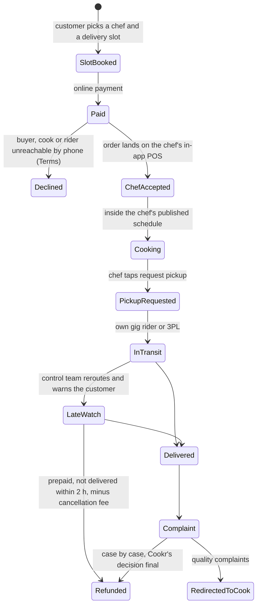

# REA Systems & Security Blueprint: Cookr

Evidence date: 24 Oct 2026 · Confidence: medium on model and policy, low on app internals ·
Method and labels: [README](README.md)

> **Verdict.** Cookr is the closest model to Craves, a home-chef marketplace with its own riders and
> subscriptions, and it shows where that model breaks. Its strongest flow is turning untrained home
> cooks into FSSAI-registered sellers. Its weakest is everything after the sale. Quality complaints are
> pushed back to the cook, refunds are discretionary, support replies take days to months, and on the
> evidence date **its main and franchise websites were serving expired TLS certificates**, so its
> privacy policy, terms and grievance page could not be reached over valid HTTPS. Pivot signals
> (franchising, the founder's AI venture, apps not updated for 9-11 months) suggest the consumer
> operation is not the priority.

## 0. Target identity and coverage

| Item | Value | Evidence |
| --- | --- | --- |
| Entity | Cloudify Technologies Pvt Ltd (CIN U72900TZ2022PTC038195), Chennai HQ, registered office in Hosur | EV-CKR-05, EV-CKR-12 |
| Apps | Customer `com.cookr.customer` (10L+ installs, 3.9★); chef `com.cookr.homechef` (1L+, 3.0★); rider `com.cookr.deliverypartner` (50K+, 3.2★) | EV-CKR-08 |
| Web | `cookr.in` (expired certificate), `www.cookr.in` (Cloudflare, redirects to the apex), `franchise.cookr.in` (expired certificate) | EV-CKR-01..04 |
| Model | Home-chef marketplace with slot-based delivery, subscriptions and bulk orders; 20-30% commission; own gig riders plus third-party logistics | EV-CKR-05, EV-CKR-09, EV-CKR-10 |
| Status | Operating, with pivot signals: franchising (2026), the founder's Comixo.AI, customer app last updated 30 Jan 2026 | EV-CKR-08, EV-CKR-11, EV-CKR-13 |

### Investigation checklist

| Question | Status | Evidence |
| --- | --- | --- |
| Certificate pinning and MitM defence | **Answered for web (failing)**; unresolved for apps | EV-CKR-01..04 |
| Session and token management | **Partial**: phone OTP, one-account rule | EV-CKR-05, EV-CKR-08 |
| Device and environment verification | **Partial**: declared data only | EV-CKR-07 |
| Order pipeline and state machine | **Partial**: slot model from Terms and interviews | EV-CKR-05, EV-CKR-09, EV-CKR-10 |
| Refund and dispute automation | **Answered** (contract) | EV-CKR-05 |
| Network edge cases | **Unresolved** | n/a |
| Support operations | **Answered** | EV-CKR-05, EV-CKR-08 |

## 1. Application security and attack surface

### 1.1 Certificate pinning and network protection

- **Observation:** `cookr.in` presents a GoDaddy `*.cookr.in` certificate valid **6 Jul to 2 Sep 2026**,
  52 days expired on the evidence date. curl fails with "certificate has expired" (EV-CKR-01).
- **Observation:** `www.cookr.in` sits behind Cloudflare with a valid certificate (Google Trust
  Services, to 9 Jan 2027), but answers **301 to the expired apex**. A visitor who types the www
  address still lands on a browser warning (EV-CKR-02).
- **Observation:** `franchise.cookr.in` presents a GoDaddy certificate that expired on **16 Jul 2026**
  (100 days) (EV-CKR-03).
- **Observation:** a headless browser got HTTP 502 at the apex, and an independent fetcher got HTTP 503
  (EV-CKR-04).
- **Consequence:** the privacy policy, terms, refund policy and grievance-officer page cannot be read
  over valid TLS. Users are being trained to click through certificate warnings on the brand's own
  domain, which is exactly the habit a phishing or MitM attacker needs.
- **Unknown:** app certificate pinning. There is no security.txt or disclosure policy, and the www
  path redirects to the failing apex.

### 1.2 Session and token management

- **Inference from declarations and reviews:** login is by phone OTP. Phone number is declared for
  "Account management", and reviews from 2023 report OTPs not arriving (EV-CKR-07, EV-CKR-08).
- **Documented:** one account per person, and Cookr may suspend extra accounts without compensation
  (EV-CKR-05).
- **Unknown:** 2FA, device binding, token storage and session revocation.

### 1.3 Device and environment verification

- **Documented declaration:** name, user IDs, address, phone and precise location are collected for
  "Fraud prevention, security, and compliance". The customer app declares "No data shared"
  (EV-CKR-07).
- **Contradiction:** the Apple label says Cookr tracks users by location and contact info. The chef app
  declares only location, and the rider app "No data collected", although onboarding handles FSSAI
  documents and payout data and the rider app streams location (EV-CKR-07). The declarations are
  probably incomplete.
- **Unknown:** integrity checks and root or emulator policy. The SDK inventory is unavailable (Exodus
  unreachable; AppBrain counts 44-46 libraries without names) (EV-CKR-15).

## 2. Customer handling, reconciliation and fault tolerance

### 2.1 Order pipeline and state machine

Reconstructed from the Terms (EV-CKR-05), the chef-app listing (EV-CKR-08) and interviews
(EV-CKR-09, EV-CKR-10).

- **Single source:** each order is tracked against a "five-stage SLA". A control team watches for
  delays, reroutes deliveries and warns customers early. Complaints about salt or spice were first
  passed to chefs by hand and later automatically (EV-CKR-10).
- **Documented:** Cookr may decline an order if it cannot reach the buyer, cook or rider by phone
  (EV-CKR-05). Inference: a manual guard against fake orders and over-committed chefs.
- **Documented:** delivery is in booked slots and sold as "slow & healthy food", which sets
  expectations away from speed (EV-CKR-09).

### 2.2 Refund and dispute automation

- **Contract (EV-CKR-05):**
  - a prepaid order not delivered within 2 hours may be refunded **after any cancellation fee**;
  - up to 100% may be refunded where the seller or Cookr caused the failure, case by case;
  - "Our decision on refunds shall be final and binding";
  - otherwise no refund after purchase unless Cookr made an error.
- **Single source, third party:** 5-7 days back to the original payment method, and a 90-second
  cancellation window (EV-CKR-16).
- **Quality disputes are outsourced to the seller:** Cookr "shall notify the same to Cook and shall
  also redirect the Buyer to the consumer call centre of the Cook. The Cook shall be liable for
  redressing Buyer complaints" (EV-CKR-05). Under franchising, local partners own quality and
  grievances (EV-CKR-11).
- **Refund-fraud defence = narrow eligibility and discretion.** No automated adjudication is
  documented.

### 2.3 Network edge cases (crash, offline, double charge)

- **Unknown:** no public material on payment reconciliation, idempotency or app-kill recovery. The
  payment gateway could not be identified.

### 2.4 Support operations

| Layer | What Cookr runs | Evidence |
| --- | --- | --- |
| Tier 0 | No in-app assistant seen; AI scores recorded support calls to flag agent errors (single source) | EV-CKR-10 |
| Tier 1 | Email support@cookr.in (every store reply points there); phone and WhatsApp +91 73730 73078 | EV-CKR-08, EV-CKR-16 |
| Tier 2 | Grievance officer Mr. Nirmal Kumar, grievances@cookr.in, Mon-Fri 09:00-18:00, under the IT Act and E-Commerce Rules 2020 | EV-CKR-05 |
| Measured latency (signals) | Store-review replies after 4 days (customer), 69 days (chef), 139 days (rider), 347 days (iOS refund complaint) | EV-CKR-08 |

## 3. Trust, privacy and compliance

**Chef vetting.** Cookr publishes no official description; these steps are pieced together from
several sources (EV-CKR-06, EV-CKR-08, EV-CKR-09).

1. The chef applies in the Home Chef app, and Cookr reviews the application.
2. Cookr screens the chef and matches them to a cuisine specialty.
3. The chef must have FSSAI registration, and Cookr helps them get it.
4. Cookr visits the kitchen.
5. The chef cooks a sample.
6. The chef is trained.
7. The chef publishes a master menu, a cooking schedule and prices, and runs orders on the in-app POS.
8. After launch, the checks are customer ratings and Cook Relationship Leads.

There is **no published hygiene scoring, repeat audit, lab testing or display of FSSAI numbers**.

- **Regulatory pressure:** FSSAI's Dec 2024 advisory bars platforms from listing unregistered sellers
  and encourages them to show licence numbers and hygiene ratings. From 1 Apr 2026, basic registration
  covers turnover up to ₹1.5 Cr, so nearly every home chef needs only basic registration (EV-CKR-14).
- **Riders:** "professionally trained", with manual onboarding waits of 1-3 months (signals). No
  background-check evidence found. Historically, customers tracked orders by phoning the rider
  (EV-CKR-08).
- **Privacy:** the store declarations contradict each other (section 1.3), and the Terms cite the 2011
  intermediary rules, replaced in 2021. No DPDP reference was found, although the full text could not
  be read over valid TLS (EV-CKR-05, EV-CKR-07).

## 4. Best-in-market flows

| Flow | Mechanism | Why it works | Evidence |
| --- | --- | --- | --- |
| **Compliance onboarding for home cooks** | In-app signup, FSSAI registration assisted by Cookr, kitchen visit, sample cook, training, then menu, schedule and POS | The real barrier for home cooks ("skilled, middle-income women") is paperwork and logistics, and Cookr removes both | EV-CKR-06, EV-CKR-09 |
| **Slot-based delivery with a control team** | Chefs publish schedules, customers book slots, the chef requests pickup, and the control team watches a five-stage SLA | Home kitchens cannot cook on demand, and batching by slot matches supply to demand | EV-CKR-09, EV-CKR-10 |
| **Diet-specific subscriptions** | Plans from ₹99, pregnancy, diabetic, Jain and Satvik menus, "subscribe to favourite home meals" (Jan 2026), Cookr Coins | Recurring revenue and a predictable workload for chefs | EV-CKR-08, EV-CKR-10 |
| **Asset-light franchising** (2026) | Exclusive territories with a 3, 5 or 7 km radius and 10-25 chefs; the partner recruits, quality-checks, delivers and handles escalations | Supply grows without head-office headcount (72 staff) | EV-CKR-11 |

## 5. Weak spots

1. Expired TLS on the primary and franchise domains, a broken trust anchor (EV-CKR-01..03).
2. A discretionary refund policy that deducts fees and sends quality complaints back to the cook
   (EV-CKR-05).
3. Email-first support with replies taking days to months (EV-CKR-08).
4. Store privacy declarations that contradict each other (EV-CKR-07).
5. Stale apps, plus slow chef and rider onboarding (EV-CKR-08).
6. Quality control spread across franchise partners (EV-CKR-11).
7. 20-30% commission, plus chef complaints about low earnings. This creates a reason to take repeat
   customers off-platform to WhatsApp (EV-CKR-08, EV-CKR-10).

## 6. Residual unknowns

| Unknown | What would resolve it |
| --- | --- |
| App pinning, token storage, integrity checks | Authorised static analysis of the shipped APK |
| Payment gateway, reconciliation and idempotency | Cookr engineering publications; none found |
| Live policy text | Re-read once `cookr.in` serves a valid certificate. Terms were read through a search index |
| SDK inventory | Exodus, unreachable on 24 Oct 2026 |

## Evidence ledger

| ID | Type | Observation or claim | Source |
| --- | --- | --- | --- |
| EV-CKR-01 | Live observation | `cookr.in` certificate (GoDaddy DV R1v1) notAfter 2026-09-02; curl reports "certificate has expired" | openssl/curl, 2026-10-24T11:3xZ |
| EV-CKR-02 | Live observation | `www.cookr.in` returns 301 to the apex (Cloudflare); www certificate valid to 2027-01-09 | curl/openssl, 2026-10-24 |
| EV-CKR-03 | Live observation | `franchise.cookr.in` certificate (GoDaddy G2) notAfter 2026-07-16 | openssl, 2026-10-24 |
| EV-CKR-04 | Live observation | Headless Chromium got 502 at the apex; an independent fetcher got 503 | Playwright 2026-10-24T11:31:51Z; WebFetch |
| EV-CKR-05 | Company document (via search index) | Terms: refund clauses, one-account rule, phone-confirm decline, complaints redirected to the cook, grievance officer | [8] |
| EV-CKR-06 | Company document (via search index) | Home-chef page and FAQ: FSSAI help, application review, packaging and delivery | [9], [10] |
| EV-CKR-07 | Store declarations | Play Data safety (customer, chef, rider) and the Apple label | [2], [4], [6], [7] |
| EV-CKR-08 | Store listings and signals | Installs, ratings, update dates, reviews, reply latencies | [1], [3], [5], [7] |
| EV-CKR-09 | Reporting | Vetting steps, 250 riders, "slow food" | [17] |
| EV-CKR-10 | Single source | Five-stage SLA control team, AI call scoring, commission, CLV/NPS | [18] |
| EV-CKR-11 | Company page (via search index) | Franchise tiers and partner duties | [13] |
| EV-CKR-12 | Reporting | Funding, FY25 revenue, entity | [15], [19], [32] |
| EV-CKR-13 | Signals | The founder's Comixo.AI venture | [25] |
| EV-CKR-14 | Regulation | FSSAI e-commerce advisory (Dec 2024); basic registration up to ₹1.5 Cr (Apr 2026) | [26], [27] |
| EV-CKR-15 | Third-party analysis | Exodus unreachable; AppBrain library counts only | [24] |
| EV-CKR-16 | Third party, single source | Phone number, 90-second cancellation, 5-7 day refunds | [22] |

## Sources

Numbering matches the research brief.

1. [Google Play: com.cookr.customer](https://play.google.com/store/apps/details?id=com.cookr.customer), updated 30 Jan 2026
2. [Google Play Data safety: com.cookr.customer](https://play.google.com/store/apps/datasafety?id=com.cookr.customer)
3. [Google Play: com.cookr.homechef](https://play.google.com/store/apps/details?id=com.cookr.homechef), updated 23 Nov 2025
4. [Google Play Data safety: com.cookr.homechef](https://play.google.com/store/apps/datasafety?id=com.cookr.homechef)
5. [Google Play: com.cookr.deliverypartner](https://play.google.com/store/apps/details?id=com.cookr.deliverypartner), updated 11 Nov 2025
6. [Google Play Data safety: com.cookr.deliverypartner](https://play.google.com/store/apps/datasafety?id=com.cookr.deliverypartner)
7. [App Store: Cookr](https://apps.apple.com/in/app/cookr-celebrate-home-food/id6443843497), v2.2.6
8. [cookr.in/policies.html](https://cookr.in/policies.html), read through a search index (the site fails TLS)
9. [cookr.in/home-chef.html](https://cookr.in/home-chef.html), read through a search index
10. [cookr.in/faq.html](https://cookr.in/faq.html), read through a search index
13. [franchise.cookr.in](https://franchise.cookr.in/), read through a search index
15. [Entrackr: Cookr raises $1M pre-seed](https://entrackr.com/2023/02/home-food-marketplace-cookr-bags-1-mn-in-pre-seed-round/), 15 Feb 2023
17. [Asia Tomorrow: home chef to your door](https://www.asiatomorrow.net/ja/articles/this-india-startup-aims-to-deliver-healthy-meal-from-home-chef-to-your-door-heres-why-how-they-did), 3 Apr 2024
18. [Prodwrks: how Cookr became the Swiggy of home-cooked food](https://prodwrks.com/how-cookr-became-the-swiggy-of-home-cooked-food-for-over-1-million-users/), 25 May 2025
19. [Inc42 company page: Cookr](https://inc42.com/company/cookr/latest/)
22. [IndiaCustomerCare: Cookr](https://www.indiacustomercare.com/cookr-food-delivery-customer-care-no), updated 17 Jul 2026 (third party)
24. [AppBrain: Cookr customer app](https://www.appbrain.com/app/cookr-celebrate-home-food/com.cookr.customer), read through a search index
25. [LinkedIn: Praba (Comixo)](https://www.linkedin.com/in/praba-comixo/), 2026, read through a search index
26. [TaxGuru: FSSAI revises turnover limits](https://taxguru.in/corporate-law/fssai-revises-turnover-limits-reduce-compliance-burden-small-food-businesses.html), 13 Mar 2026
27. [Lexplosion: FSSAI advisory for e-commerce FBOs](https://lexplosion.in/fssai-issues-advisory-for-e-commerce-fbos-to-strengthen-food-safety-ecosystem-prohibits-unregistered-sellers-on-e-commerce-food-platforms/), 16 Dec 2024
32. [ZaubaCorp: Cloudify Technologies Pvt Ltd](https://www.zaubacorp.com/CLOUDIFY-TECHNOLOGIES-PRIVATE-LIMITED-U72900TZ2022PTC038195), read through a search index
