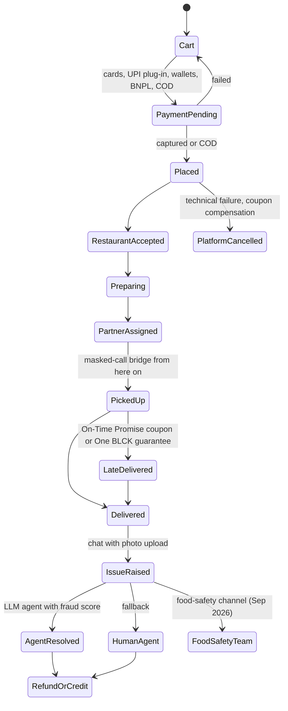

# REA Systems & Security Blueprint: Swiggy

Evidence date: 24 Oct 2026 · Confidence: medium-high on security programme, fraud and support; low on
app internals · Method and labels: [README](README.md)

> **Verdict.** Swiggy is the market's **security and fraud benchmark**:
> - certified controls (ISO 27001/27701, PCI DSS, SOC 2 Type II);
> - account-takeover fixes driven by real incidents;
> - real-time fraud scoring at the moment a refund is claimed (DeFraudNet, DevNet, SHIELD device
>   intelligence);
> - an LLM support agent that calls tools behind guardrails.
>
> Its failures are in the **human layer**. Customers cannot easily reach a person, fake helplines
> fill the gap, refund timelines are opaque under an open CCPA probe, and consumer commissions keep
> rejecting its "we are only an intermediary" defence.

## 0. Target identity and coverage

| Item | Value | Evidence |
| --- | --- | --- |
| Entity | Swiggy Ltd (formerly Bundl Technologies), listed on NSE | EV-SWG-04 |
| Consumer app | `in.swiggy.android` | EV-SWG-07 |
| Web origin | `www.swiggy.com` behind CloudFront + AWS WAF | EV-SWG-01, EV-SWG-02 |
| Scale | 27.5M monthly transacting users; food GOV ₹9,490 cr and Instamart GOV ₹7,907 cr in Q1 FY27; 6.5 lakh+ delivery partners; 1,171 dark stores | EV-SWG-04 |
| Cloud | "Architected on AWS from its founding"; RDS and EKS in a multi-AZ business-continuity design | EV-SWG-05 |

### Investigation checklist

| Question | Status | Evidence |
| --- | --- | --- |
| Certificate pinning and MitM defence | **Unresolved** for apps; web edge and security programme answered | EV-SWG-01..03, EV-SWG-05 |
| Session and token management | **Partial**: takeover incidents and fixes documented; token design unknown | EV-SWG-04, EV-SWG-14 |
| Device and environment verification | **Answered** at capability level (SHIELD) | EV-SWG-10, EV-SWG-07 |
| Order pipeline and state machine | **Partial**: customer-visible lifecycle and resilience design | EV-SWG-04, EV-SWG-05 |
| Refund and dispute automation | **Answered** (mechanism); timelines unknown | EV-SWG-08, EV-SWG-09, EV-SWG-11 |
| Network edge cases | **Partial**: documented outages and fixes | EV-SWG-04, EV-SWG-05 |
| Support operations | **Answered** | EV-SWG-04, EV-SWG-11, EV-SWG-12 |

## 1. Application security and attack surface

### 1.1 Certificate pinning and network protection

- **Observation:** a plain HTTPS client gets `HTTP/2 202` with `x-amzn-waf-action: challenge` from
  CloudFront. Headers include HSTS (`max-age=31536000`, no `includeSubDomains`), `X-Frame-Options:
  SAMEORIGIN`, `nosniff` and `Referrer-Policy: strict-origin-when-cross-origin` (EV-SWG-01).
- **Observation:** a stock headless Chromium got a hard **HTTP 403**, with no challenge and no scripts.
  Swiggy blocks headless browsers at the edge, where Zepto challenges them (EV-SWG-02).
- **Observation:** no `security.txt` at either path (404). robots.txt still lists WordPress-era paths
  and disallows `/track-order/*`, `/order-track/*` and `/ofo/track/*` (EV-SWG-03).
- **Documented programme (EV-SWG-05):** a "Unified Control Framework" combining ISO 27001:2022,
  ISO 27701:2019, PCI DSS and SOC 2 Type II, with data localisation. It includes SIEM and intrusion
  detection, third-party risk management, VAPT, and breach notification to customers and CERT-In
  "within stipulated timeframes". The FY25 and FY26 sustainability reports record zero data breaches
  (self-reported).
- **Documented disclosure programme (EV-SWG-06):**
  - reports by template to security@swiggy.in, with a reply promised within 5 working days;
  - 15+ web hosts and both apps in scope;
  - the **delivery-partner app and vendor endpoints are out of scope**;
  - no payout amounts published, and researchers accept a 5-year confidentiality term.
- **Unknown:** app certificate pinning.

### 1.2 Session and token management

- **Documented incident and fix (EV-SWG-04):** "some of our users' accounts were fraudulently taken
  over and orders were placed using their wallet pay balances". Swiggy's fix:
  - **wallet and BNPL links are removed automatically on a new-device login**;
  - **two-factor authentication** was added.
- **Documented attack pattern (EV-SWG-14):** in Feb 2024, fraudsters used IVR calls to get victims'
  OTPs, linked a phone number they controlled, and spent ₹97,197 of LazyPay credit. Inference: phone
  re-binding and stored credit were the weak links, and both are what the fix above targets.
- **Bug-bounty exclusions:** forgot-password brute force, missing CAPTCHA, non-severe rate limiting
  and session timeouts are not rewarded (EV-SWG-06).
- **Payments:** Swiggy UPI is built on the NPCI UPI plug-in with Juspay HyperUPI, and every payment
  needs the UPI PIN (EV-SWG-13).
- **Unknown:** token format, storage and rotation, and where the 2FA prompt applies.

### 1.3 Device and environment verification

- **Documented capability (EV-SWG-10, vendor):** the SHIELD "device-first risk AI" uses device
  identity to unmask fake accounts built with **app cloners or tampered apps** (promo, signup and
  referral abuse), and to catch delivery partners **spoofing GPS** to hit incentive targets.
- **Documented declaration (EV-SWG-07):** installed apps, device IDs, precise location, phone number
  and photos are collected for "fraud prevention". Device IDs are also shared for advertising.
- **Inference:** device fingerprinting plus the installed-apps list effectively covers rooted,
  emulated and cloned devices, without blocking every rooted user at launch.
- **Unknown:** Play Integrity or App Attest use.

## 2. Customer handling, reconciliation and fault tolerance

### 2.1 Order pipeline and state machine

Reconstructed from the filings (EV-SWG-04, EV-SWG-05) and product reporting (EV-SWG-15). Internal
states and orchestration are not public.

- **Documented resilience (EV-SWG-05):**
  - critical workloads run across independent AWS Availability Zones;
  - **continuous backups and cross-AZ failover for RDS and EKS**;
  - recovery is governed by defined **RTO and RPO** targets, prioritised by business-impact analysis;
  - order-level disruptions are announced automatically by push, SMS and email.
- **Documented compensation:** coupons when technical failures cancel orders (EV-SWG-04). A ₹75
  On-Time Promise coupon in 12 markets (EV-SWG-15). An on-time guarantee for One BLCK members
  (EV-SWG-16).
- **Documented privacy in transit:** customer and delivery-partner calls have gone through a
  number-masking bridge since Dec 2015 (EV-SWG-17).

### 2.2 Refund and dispute automation

- **Support engine (EV-SWG-11, vendor):**
  - an intent LLM routes each issue to a specialist agent;
  - **agents must call backend tools, run behind guardrails and write their actions to the CRM**;
  - there is a fallback to humans.

  PubNub, also a vendor, reports up to 70% of tickets automated, 30-40 second resolutions and about
  200k inquiries a day (EV-SWG-12).
- **Fraud scoring when a refund is claimed (gold standard):**
  - **DeFraudNet** (ECML-PKDD 2021): weak-supervision labels (Snorkel plus rules), cleaned by an
    autoencoder; an MLP+LSTM ensemble; **GCN embeddings over a customer-to-customer graph** to catch
    collusion; real time, with +16 points of recall at fixed precision (EV-SWG-08).
  - **DevNet** (Feb 2024): semi-supervised scoring of "false complaints for monetary gains and instant
    free food" (EV-SWG-09, snippet only).
  - **SHIELD** device identity (EV-SWG-10).
- **Contract and channels:** wrong or defective items get a refund or replacement, there is no returns
  policy, and customers can upload photos in chat. "A majority of the complaints are resolved within
  48 hours" (EV-SWG-04). Wallet refunds were instant on Swiggy Money (2020) (EV-SWG-18).
- **Weak spot:** no official refund timeline was found. 10,500+ National Consumer Helpline complaints,
  900+ of them about unprocessed refunds. The CCPA order of 16 Oct 2024 on refunds is still pending.
  Operators admit stricter refund systems "increased friction in genuine cases" (EV-SWG-04,
  EV-SWG-19, EV-SWG-20).

### 2.3 Network edge cases (crash, offline, double charge)

- **Documented incident:** on 31 Dec 2021 a third-party chat module failed for about **160 minutes**,
  and was fixed by restarting the module (EV-SWG-04).
- **Documented incident:** on 18 Jun 2024 a nationwide outage at a third-party ISP hit several Swiggy
  apps. Monitoring detected it, critical domains were moved onto a **CDN**, and service was restored
  within 6 hours. Critical applications have stayed on the CDN since (EV-SWG-04).
- **Documented design:** multi-AZ failover and defined RTO/RPO (EV-SWG-05).
- **Unknown:** idempotency keys, payment-status reconciliation and app-kill recovery are not
  published. Inference: refund handling through tool-calling agents implies a payment-status lookup
  that the agent can call.

### 2.4 Support operations

| Layer | What Swiggy runs | Evidence |
| --- | --- | --- |
| Tier 0 | FAQs, AI chatbot, in-app messaging with photo upload, a rating after every chat | EV-SWG-04, EV-SWG-05 |
| Tier 1 | Human agents, with "top" agents for One BLCK members; a 24/7 experience team | EV-SWG-05, EV-SWG-16 |
| Tier 2 | grievances@swiggy.in; Food Safety Assurance Team with helpline 7948231850 (Sep 2026) | EV-SWG-21, EV-SWG-22 |
| Phone | The Dec 2025 filing lists +91-80-6842-2422, but in Oct 2026 Swiggy said it "does not offer a conventional customer care phone number for order-related help". A customer lost ₹34,000 to a fake helpline | EV-SWG-04, EV-SWG-23 |

## 3. Trust, privacy and compliance

- **Restaurant trust:** the Swiggy Seal is built on 7M+ verified reviews, with discounted FSSAI-agency
  audits for restaurants, and can be revoked. Inference: it rests on reviews, not inspections
  (EV-SWG-24).
- **Instamart enforcement in 2026:** FSSAI notices, Maharashtra FDA licence suspensions, FSSAI penal
  action and Telangana dark-store suspensions (EV-SWG-25).
- **Consumer commissions:** they keep rejecting the intermediary defence, over inflated delivery
  distance, prawn in a vegan order and short weight (EV-SWG-26).
- **Riders:** 100% of accident and health insurance premiums paid, covering 25 lakh+ partners in FY26.
  In-app SOS, Dial 4242 ambulances, and a right to refuse unsafe service (EV-SWG-05). Police
  verification was criticised in Mar 2026 (EV-SWG-27).
- **Privacy (EV-SWG-07):** Play declares payment info, precise location and device IDs (including for
  ads) as shared. Exodus extracts of Jan 2025 builds list 11-12 trackers: AppsFlyer, Singular, Facebook
  Analytics, Google, CleverTap, MoEngage, New Relic, Sentry, AdMob. Those extracts are unverified, as
  Exodus returned 503 (EV-SWG-28). Swiggy reports DPDP policies "implemented" and ISO 27701 privacy
  governance (EV-SWG-04, EV-SWG-05).

## 4. Best-in-market flows

| Flow | Mechanism | Why it works | Evidence |
| --- | --- | --- | --- |
| **Fraud scoring when a refund is claimed** | Weak-supervision labels, GCN collusion graph, DevNet false-complaint scoring and SHIELD device identity combine into a real-time score before money moves | Food can't be returned, so the only defence is deciding correctly up front. Years of labelled history across 27.5M users make the models strong | EV-SWG-08..10 |
| **LLM support agent with tool calls** | Intent routing, specialist agents, required backend tools, guardrails, writes to the CRM, human fallback | Policy applied identically to about 200k inquiries a day, with an audit trail for every action | EV-SWG-11, EV-SWG-12 |
| **Account-takeover hardening learned from incidents** | Wallet and BNPL unlinked on a new device, 2FA, a PIN for each UPI payment | It closes the exact path attackers used (phone re-bind, then stored credit) | EV-SWG-04, EV-SWG-13, EV-SWG-14 |
| **Certified security baseline and resilience** | ISO 27001/27701, PCI DSS, SOC 2 Type II, SIEM, multi-AZ RDS and EKS, RTO/RPO, CDN failover | Audited controls plus documented recovery targets | EV-SWG-04, EV-SWG-05 |
| **Service guarantees paid in credit** | On-Time Promise coupons, One BLCK guarantee, coupons for outage cancellations | Credit costs less than cash and keeps users ordering (members order 5.80x vs 4.12x) | EV-SWG-04, EV-SWG-15, EV-SWG-16 |
| **Rider safety net** | Fully paid insurance, SOS, ambulances, masked calls since 2015 | Lower attrition and regulatory cover | EV-SWG-05, EV-SWG-17 |

## 5. Weak spots

1. Humans are hard to reach, which pushes customers to fake helplines (EV-SWG-23).
2. Opaque refunds and cancellation charges under an open CCPA probe (EV-SWG-19, EV-SWG-20).
3. The intermediary defence keeps losing in consumer commissions (EV-SWG-26).
4. Instamart's food-safety enforcement record in 2026 (EV-SWG-25).
5. No security.txt, and the delivery-partner app is out of bug-bounty scope (EV-SWG-03, EV-SWG-06).
6. Rider vetting under scrutiny (EV-SWG-27).
7. Inference: tooling built around single orders. Meal-plan pause, skip and missed-meal credit are
   white space.

## 6. Residual unknowns

| Unknown | What would resolve it |
| --- | --- |
| App pinning, token storage, integrity APIs | Authorised static analysis of the shipped APK |
| Order orchestration engine, idempotency, payment reconciliation | Swiggy Bytes engineering posts (bytes.swiggy.com returned 503 during research) |
| Refund timelines, grievance officer name | Swiggy's help and terms pages render only with JavaScript; re-read in a browser |
| Verified SDK inventory | Exodus, unavailable on 24 Oct 2026 |

## Evidence ledger

| ID | Type | Observation or claim | Source |
| --- | --- | --- | --- |
| EV-SWG-01 | Live observation | 202 + `x-amzn-waf-action: challenge` (CloudFront); HSTS, XFO, nosniff, Referrer-Policy | curl, 2026-10-24T11:28Z |
| EV-SWG-02 | Live observation | Headless Chromium got a hard 403, with no scripts served | Playwright, 2026-10-24T11:31:31Z |
| EV-SWG-03 | Live observation | security.txt 404 at both paths; robots.txt contents | curl, 2026-10-24 |
| EV-SWG-04 | Company document | QIP placement document: account takeover and fix, fraud types, incidents, outages, channels, 48-hour resolution, CCPA/CCI/GST matters | [4] |
| EV-SWG-05 | Company document | FY26 annual report and BRSR: certifications, 0 breaches, multi-AZ BCDR, RTO/RPO, disruption alerts, rider welfare | [5], [6] |
| EV-SWG-06 | Company document | Bug-bounty page: scope, exclusions, 5-working-day reply | [8] |
| EV-SWG-07 | Store declaration | Play Data safety for `in.swiggy.android` | [10] |
| EV-SWG-08 | Engineering paper | DeFraudNet | [19] |
| EV-SWG-09 | Engineering blog (snippet) | DevNet false-complaint model | [20] |
| EV-SWG-10 | Vendor case study | SHIELD device intelligence | [21], [22] |
| EV-SWG-11 | Vendor case study | Databricks: LLM support agent | [24] |
| EV-SWG-12 | Vendor case study | PubNub: 70% automation, about 200k inquiries a day | [25] |
| EV-SWG-13 | Company blog | Swiggy UPI (NPCI plug-in, Juspay HyperUPI) | [17] |
| EV-SWG-14 | Reporting | IVR account-takeover arrests, Feb 2024 | [16] |
| EV-SWG-15 | Reporting | ₹75 On-Time Promise | [30] |
| EV-SWG-16 | Reporting | One BLCK benefits | [29] |
| EV-SWG-17 | Reporting | Number masking and background checks, 2015 | [46] |
| EV-SWG-18 | Reporting | Swiggy Money instant wallet refunds, 2020 | [18] |
| EV-SWG-19 | Reporting | NCH complaint counts; CCPA refund push | [36] |
| EV-SWG-20 | Reporting | Chatbot loops; stricter refund systems | [27] |
| EV-SWG-21 | Company document | Grievance-redressal policy | [7] |
| EV-SWG-22 | Reporting | Food-safety helpline, Sep 2026 | [31] |
| EV-SWG-23 | Reporting | Fake-helpline scam; "no conventional customer care phone number" | [28] |
| EV-SWG-24 | Reporting | Swiggy Seal | [45] |
| EV-SWG-25 | Reporting | Instamart enforcement, Jul-Sep 2026 | [32], [33], [34], [35] |
| EV-SWG-26 | Reporting | Consumer-commission rulings | [39], [40], [41] |
| EV-SWG-27 | Reporting | Police-verification criticism, Mar 2026 | [47] |
| EV-SWG-28 | Third-party analysis | Exodus tracker extracts (unverified) | [11] |

## Sources

Numbering matches the research brief.

4. [Swiggy QIP placement document](https://www.swiggy.com/corporate/wp-content/uploads/2025/12/Swiggy-Limited-Placement_Document.pdf), 12 Dec 2025
5. [Swiggy Annual Report FY26](https://www.swiggy.com/corporate/wp-content/uploads/2026/07/annual-report-2025-26.pdf), Jul 2026
6. [Swiggy BRSR FY25](https://www.swiggy.com/corporate/wp-content/uploads/2025/07/Swiggy-AR-FY25_BRSR_29.07.25.pdf), 29 Jul 2025
7. [Swiggy Stakeholder Engagement and Grievance Redressal Policy](https://www.swiggy.com/corporate/wp-content/uploads/2025/08/Stakeholder-Engagement-and-Grievance-Redressal-Policy-.pdf), Aug 2025
8. [Swiggy bug bounty](https://www.swiggy.com/bug-bounty), read 24 Oct 2026
10. [Google Play Data safety: in.swiggy.android](https://play.google.com/store/apps/datasafety?id=in.swiggy.android&hl=en_IN), read 24 Oct 2026
11. [Exodus Privacy: Swiggy reports 550010 and 556121](https://reports.exodus-privacy.eu.org/en/reports/550010/), Jan 2025 (503 during research; search extracts only)
16. [Siasat: hackers order ₹97k from a victim's Swiggy account](https://www.siasat.com/hackers-place-order-of-over-rs-97k-from-victims-swiggy-account-two-held-2980014/), 19 Feb 2024
17. [Swiggy blog: Swiggy UPI](https://blog.swiggy.com/2024/08/14/swiggy-launches-swiggy-upi-for-faster-payment-experience), 14 Aug 2024
18. [The News Minute: Swiggy Money](https://www.thenewsminute.com/atom/swiggy-unveils-digital-wallet-swiggy-money-partnership-icici-bank-127643), 30 Jun 2020
19. [Swiggy Bytes: DeFraudNet](https://bytes.swiggy.com/defraudnet-an-end-to-end-weak-supervision-framework-to-detect-fraud-in-online-food-delivery-22366ddce461) and [ECML-PKDD 2021](https://mlanthology.org/ecmlpkdd/2021/mathew2021ecmlpkdd-defraudnet)
20. [Swiggy Bytes: DevNet for fraud detection](https://bytes.swiggy.com/utilizing-devnet-with-variational-loss-for-fraud-detection-in-hyperlocal-food-delivery-19e72999acfb), 23 Feb 2024
21. [CXOToday: Swiggy uses SHIELD](https://cxotoday.com/press-release/swiggy-leverages-shields-device-first-risk-ai-platform-to-enhance-its-fraud-prevention-and-detection-capabilities/), 21 May 2024
22. [SHIELD case study: Swiggy](https://shield.com/case-studies/swiggy)
24. [Databricks: Swiggy's enterprise-scale AI agent](https://www.databricks.com/blog/redefining-customer-support-swiggys-enterprise-scale-ai-agent-built-databricks), 21 Oct 2025
25. [PubNub customer story: Swiggy](https://www.pubnub.com/customers/swiggy/), updated 12 Sep 2025
27. [Storyboard18: why AI support frustrates users](https://storyboard18.com/digital/why-ai-led-customer-support-frustrates-swiggy-zomato-users-92842.html), 21 Mar 2026
28. [The420.in: Swiggy fake customer care scam](https://the420.in/swiggy-fake-customer-care-scam/), updated 20 Oct 2026
29. [Inc42: One BLCK](https://inc42.com/buzz/swiggy-launches-new-membership-plan-one-blck), 11 Dec 2024
30. [afaqs: On-Time Promise campaign](https://www.afaqs.com/news/ooh/swiggy-launches-paet-ke-chuhe-campaign-in-mumbai-10469975), 17 Sep 2025
31. [Outlook Business: Swiggy food-safety helpline](https://www.outlookbusiness.com/corporate/swiggys-new-food-safety-helpline-how-customers-can-flag-bad-food), 7 Sep 2026
32. [Telangana Today: FSSAI notices to Instamart](https://telanganatoday.com/fssai-issues-nine-notices-to-swiggy-instamart-over-alleged-food-safety-violations), 11 Jul 2026
33. [IANS: Maharashtra FDA suspends 14 licences](https://ianslive.in/maharashtra-fda-suspends-14-food-licences-after-statewide-quick-commerce-safety-drive--20260814210456), 14 Aug 2026
34. [Inc42: FSSAI penalises Instamart and others](https://inc42.com/buzz/fssai-penalises-amazon-flipkart-instamart-over-regulatory-non-compliance/), 23 Sep 2026
35. [Deccan Chronicle: TG SAFE suspends dark-store licences](https://www.deccanchronicle.com/southern-states/telangana/tg-safe-suspends-licences-of-four-dark-stores-1992025), 30 Sep 2026
36. [Storyboard18: CCPA may direct refund policy changes](https://www.storyboard18.com/brand-marketing/ccpa-may-direct-zomato-swiggy-to-revise-cancellation-and-refund-policies-66720.htm), 21 May 2025
39. [Siasat: Swiggy fined for inflating delivery distance](https://www.siasat.com/hyderabad-swiggy-fined-rs-25000-for-artificially-increasing-delivery-distance-3124622/amp/), 2 Nov 2024
40. [Storyboard18: prawn in vegan sandwich ruling](https://www.storyboard18.com/brand-marketing/bengaluru-vegan-woman-wins-%e2%82%b91-lakh-after-finding-prawn-in-%e2%82%b9145-sandwich-ordered-on-swiggy-84295.htm), 17 Nov 2025
41. [trak.in: short-weight ruling](https://trak.in/stories/swiggy-fined-rs-2000-for-sending-176-grams-less-oranges/), 14 Nov 2025
45. [Business Today: Swiggy Seal](https://www.businesstoday.in/amp/technology/news/story/swiggys-new-seal-badge-explained-food-delivery-platform-introduces-new-program-to-maintain-hygiene-451293-2024-10-23), 23 Oct 2024
46. [Restaurant India: Swiggy security measures](https://www.restaurantindia.in/news/food-delivery-company-swiggy-adopts-stringent-security-measures-for-customers.n9640), 24 Dec 2015
47. [Scroll: mandatory police verification of gig workers](https://scroll.in/latest/1091093/maharashtra-mandatory-police-verification-of-gig-workers-soon-says-minister), 2 Mar 2026
