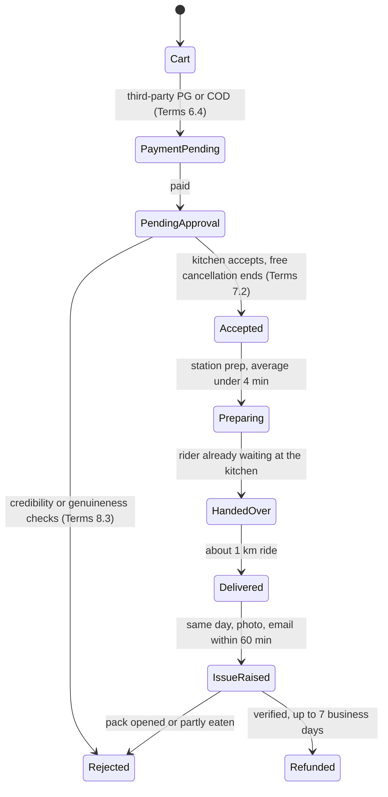

# REA Systems & Security Blueprint: Swish

Evidence date: 24 Oct 2026 · Confidence: medium on operations, low on app internals ·
Method and labels: [README](README.md)

> **Verdict.** Swish wins on **physics, not software**: food cooked about 1 km away by a kitchen it
> owns, with a rider already waiting. Everything around that loop is thin. The refund contract is
> written against the customer, support is chat-and-email with no phone line, no FSSAI number is
> published, the privacy policy predates DPDP, and there is no security disclosure programme beyond a
> one-name hall of fame. A challenger cannot out-run Swish, but it can out-trust it.

## 0. Target identity and coverage

| Item | Value | Evidence |
| --- | --- | --- |
| Entity | Munchmart Technologies Pvt Ltd, HSR Layout, Bengaluru (incorporated Jul 2024) | EV-SWS-05, EV-SWS-08 |
| Apps | Android `com.swishapp` (10L+ installs, 4.7★); iOS id 6504881715 (v2.9.0) | EV-SWS-08 |
| Web | `justswish.in` marketing site on Framer; ordering is app-only | EV-SWS-01, EV-SWS-02 |
| Model | Own neighbourhood kitchens, about 1 km delivery radius, 250+ SKUs, average prep under 4 minutes (company claims) | EV-SWS-09 |
| Scale | More than 1M orders a month; "80% under 15 minutes"; Bengaluru plus Delhi NCR, about 50 pincodes; about $78M raised to Sep 2026 | EV-SWS-09 |

### Investigation checklist

| Question | Status | Evidence |
| --- | --- | --- |
| Certificate pinning and MitM defence | **Unresolved** for the app; web is a static marketing site | EV-SWS-01 |
| Session and token management | **Unresolved**: phone number is the username; nothing else public | EV-SWS-07, EV-SWS-10 |
| Device and environment verification | **Partial**: declared data only | EV-SWS-05, EV-SWS-08 |
| Order pipeline and state machine | **Partial**: contract-level lifecycle | EV-SWS-04 |
| Refund and dispute automation | **Answered** (contract and signals) | EV-SWS-04, EV-SWS-10 |
| Network edge cases | **Signals only** | EV-SWS-10 |
| Support operations | **Answered** | EV-SWS-04, EV-SWS-10 |

## 1. Application security and attack surface

### 1.1 Certificate pinning and network protection

- **Observation:** `justswish.in` is served by Framer with HSTS (1 year) and `nosniff`, and **no CSP**.
  `www` redirects to the apex with a 308 (EV-SWS-01).
- **Observation:** one page load made 48 requests to 9 hosts (Framer CDN and analytics, jsDelivr GSAP
  3.13.0, Google Fonts, a YouTube thumbnail). It set no cookies and used no storage. There is no
  login surface on the web, so the attack surface that matters is the app and its API (EV-SWS-02).
- **Observation:** no `/.well-known/security.txt` (404). A "Security: Hall of Fame" page names one
  researcher, with no policy, scope, safe harbour or security mailbox (EV-SWS-03).
- **Documented:** payment data is encrypted, data is stored on AWS "possibly outside India"
  (EV-SWS-05), and the Play listing declares encryption in transit (EV-SWS-08).
- **Single source:** a researcher posted that he "found some vulnerabilities in Swish" and that the
  team fixed them quickly (about Apr 2026) (EV-SWS-15).
- **Unknown:** app certificate pinning.

### 1.2 Session and token management

- **Documented:** the account username is the phone number (EV-SWS-07). The Terms make users "fully
  responsible for all activities" on their account (3.3), and Swish disclaims liability for
  unauthorised transactions made with a user's payment details (4.5) (EV-SWS-04).
- **Documented anti-scam control:** Terms 8.4 says Swish will "NEVER" ask for card number, CVV, OTP
  or UPI PIN, warns about lookalike sites and payment links, and points to cybercrime.gov.in
  (EV-SWS-04).
- **Signal:** the order list kept redirecting a user to login (13 Sep 2026), a session-handling
  defect (EV-SWS-10).
- **Unknown:** OTP design, token storage, rotation and revocation.

### 1.3 Device and environment verification

- **Documented collection:** device IDs, the device's phone number, IP address, precise location
  (foreground and background) and a **"list of third-party applications being used by You"**
  (EV-SWS-05). Play declares device IDs as shared for analytics and app functionality (EV-SWS-08).
- **Inference:** this is enough for multi-account and emulator detection. Swish does not say it
  uses the data that way.
- **Rider side (documented):** KYC (PAN, ID, address, bank), a background-verification meeting, no
  criminal record, licence and vehicle papers, a refundable deposit, and a ban on sharing Partner App
  access (EV-SWS-06).
- **Unknown:** Play Integrity, root or emulator policy.

## 2. Customer handling, reconciliation and fault tolerance

### 2.1 Order pipeline and state machine

Reconstructed from the Terms (EV-SWS-04) and company and press statements (EV-SWS-09, EV-SWS-14).
Internal states and orchestration are not public.

- **Documented order gate:** Swish "may do such checks as it deem fit before approving the User's
  order". It can reject an order over the "credibility of the User or genuineness of the
  transaction", and can delay or cancel on suspicion or "high transaction volumes" (Terms 8.3)
  (EV-SWS-04).
- **Single source:** riders wait at the kitchen, are ranked by idle time, and staff confirm each
  assignment (EV-SWS-14).
- **Documented:** the ETA is shown, but Swish "does not guarantee the delivery within the said time"
  (6.1). Fees can apply for rain, peak hours, late night, packing, platform use and small carts
  (EV-SWS-04).

### 2.2 Refund and dispute automation

- **Contract (EV-SWS-04):** refunds only for a wrong item or one "substantially damaged or
  deteriorated"; photo proof required (7.1.1); nothing accepted once the pack is opened or the food
  is "consumed either in part" (7.1.2); claims the same day (7.1.3), by email within 60 minutes
  (16.1.2); refund within **7 business days after verification** (7.3). The refund destination is not
  stated.
- **Refund-fraud defence = friction:** strict evidence and time windows, verification by hand, and
  the right to refuse "unethical" accounts (14.2). There is no automated adjudication (EV-SWS-04).
- **Quality disclaimer:** clause 8.1 calls Swish "merely a reseller" that disclaims "quality, taste",
  although it cooks the food itself (EV-SWS-04).
- **Promo limits (signals):** the wallet covers only 20-40% of an order, can't be combined with
  coupons, and rewards need manual cart steps. This curbs abuse but users call it a "trick"
  (EV-SWS-10).

### 2.3 Network edge cases (crash, offline, double charge)

- **Signals (EV-SWS-10):**
  - "payment deducted but marked failed", with a refund taking about 10 days;
  - an order shown as "Delivered" but never received;
  - a location error that cancelled an order without asking the customer.

  Inference: captured-but-unconfirmed payments go through the slow manual refund path rather than an
  automatic reconcile-and-refund.
- **Inference, positive:** "Kitchen maintenance is taking a while" blocked checkout for 3 hours on
  12 Sep 2026. A kitchen-level availability switch refuses orders upstream instead of accepting and
  then cancelling them, which is the right failure mode.
- **Unknown:** idempotency, reconciliation jobs, app-kill recovery.

### 2.4 Support operations

| Layer | What Swish runs | Evidence |
| --- | --- | --- |
| Tier 0 | In-app "Get Help" chat; no public evidence of a bot | EV-SWS-04, EV-SWS-10 |
| Tier 1 | Email: the Terms use hello@, while the site and store replies use support@ | EV-SWS-04 |
| Tier 2 | "Grievance cum Nodal Officer": acknowledge in 48 h, resolve within 30 days; the privacy grievance officer is the CEO | EV-SWS-04, EV-SWS-05 |
| Phone or WhatsApp | **None published**, though staff do call customers back during delays (signals) | EV-SWS-10 |

## 3. Trust, privacy and compliance

- **Food safety:** no FSSAI licence number on the website or in the Terms, and no audits, hygiene
  ratings or kitchen cameras published (EV-SWS-04). FSSAI's Jul 2025 directions require licence
  numbers on receipts and FoSTaC-trained handlers (EV-SWS-12). Signals include a chicken wrap
  delivered to a vegetarian and complaints of illness (EV-SWS-10).
- **Riders:** the partner terms make riders independent contractors who pay their own insurance,
  onboarding fees and deposit, allow third-party delivery vendors, and still carry quick-commerce
  template text such as cigarette and alcohol delivery clauses (EV-SWS-06). Swish still brands itself
  "10-Min Food Delivery" after the Jan 2026 Labour Ministry advisory (EV-SWS-11).
- **Privacy:** written under the IT Act and SPDI Rules with no DPDP reference, no retention periods,
  no breach commitment and possible cross-border AWS storage. Deletion is by email in 3-5 working
  days (EV-SWS-05, EV-SWS-07). The Apple label says the phone number is "not linked" to the user,
  although it is the login (EV-SWS-08).
- **SDKs:** the Exodus report was unavailable (HTTP 503). Inference: AppsFlyer, from the
  `swish.onelink.me` download link (EV-SWS-13).

## 4. Best-in-market flows

| Flow | Mechanism | Why it works | Evidence |
| --- | --- | --- | --- |
| **Kitchen-to-door proximity loop** | Dense kitchens, menu built for prep under 4 minutes, robotic equipment, riders waiting at the kitchen, a 1 km radius | Removes the restaurant wait and the long ride, the two big parts of a marketplace ETA; the short ride keeps food hot | EV-SWS-09, EV-SWS-14 |
| **Full-stack ownership** | Swish owns sourcing, recipes, kitchens, app and fleet | No 16-30% commission layer, so cheap tickets (₹200-250) still work, and one owner answers for every failure | EV-SWS-09 |
| **Density-first expansion** | Collects "bring Swish here" demand (25,000 requests) before opening hubs | Each kitchen only pays off with repeat orders inside its circle | EV-SWS-09 |
| **Upstream availability switch** (inference) | Checkout closes when a kitchen can't fulfil | Prevents accept-then-cancel refunds | EV-SWS-10 |

## 5. Weak spots

1. A refund contract built against the customer: an opened or part-eaten pack voids the claim,
   refunds take 7 business days, and there is no compensation for lateness (EV-SWS-04).
2. A "reseller" disclaimer of food quality despite cooking the food itself (EV-SWS-04).
3. No published FSSAI number, audits or veg/non-veg segregation (EV-SWS-04).
4. Thin support: slow chat, two support emails, no phone (EV-SWS-10).
5. An immature security programme: no security.txt or disclosure policy (EV-SWS-03).
6. A pre-DPDP privacy posture with deletion by email (EV-SWS-05, EV-SWS-07).
7. Exposure from the "10-minute" branding after the Labour Ministry advisory (EV-SWS-11).

## 6. Residual unknowns

| Unknown | What would resolve it |
| --- | --- |
| App pinning, token storage, integrity checks | Authorised static analysis of the shipped APK |
| Payment reconciliation and idempotency | Swish engineering publications; none found |
| SDK inventory | The Exodus report, unavailable on 24 Oct 2026 |

## Evidence ledger

| ID | Type | Observation or claim | Source |
| --- | --- | --- | --- |
| EV-SWS-01 | Live observation | `justswish.in` 200 (Framer), HSTS, nosniff, no CSP; www returns 308 | curl, 2026-10-24 |
| EV-SWS-02 | Live observation | Headless Chromium: 48 requests, 9 hosts, no cookies or storage | Playwright, 2026-10-24T11:32:02Z |
| EV-SWS-03 | Live observation | `/.well-known/security.txt` 404; one-name hall-of-fame page | [6] |
| EV-SWS-04 | Company document | Terms: order checks 8.3, refund rules 7.1-7.3, cancellation 7.2, ETA 6.1, reseller 8.1, anti-scam 8.4, grievance 16.2 | [2] |
| EV-SWS-05 | Company document | Privacy policy: installed apps, background location, AWS storage, CEO as grievance officer | [3] |
| EV-SWS-06 | Company document | Partner terms: KYC, background meeting, self-funded insurance, third-party vendors | [4] |
| EV-SWS-07 | Company document | Deletion by email, 3-5 working days | [5] |
| EV-SWS-08 | Store declarations | Play Data safety; Apple privacy label | [11], [12], [13] |
| EV-SWS-09 | Company and press | Scale, prep time, radius, robotics, funding | [8], [9], [10], [15], [16], [19], [20] |
| EV-SWS-10 | Signals | Play and App Store reviews, Jun 2025 to Sep 2026 | [11], [13] |
| EV-SWS-11 | Reporting | Labour Ministry advisory on fixed delivery-time promises | [27] |
| EV-SWS-12 | Regulation | FSSAI e-commerce directions, Jul 2025 | [32] |
| EV-SWS-13 | Third-party analysis | Exodus unavailable; AppsFlyer inferred from the OneLink link | [14], [1] |
| EV-SWS-14 | Single source | Rider idle-time dispatch (UX case study, snippet only) | [36] |
| EV-SWS-15 | Single source | Researcher post on vulnerabilities fixed (snippet only) | [37] |

## Sources

Numbering matches the research brief.

1. [justswish.in](https://justswish.in/), fetched 24 Oct 2026
2. [Swish Terms of Service](https://justswish.in/terms-of-service), fetched 24 Oct 2026
3. [Swish Privacy Policy](https://justswish.in/privacy-policy), fetched 24 Oct 2026
4. [Swish Partner Terms](https://justswish.in/partner-terms-and-conditions), fetched 24 Oct 2026
5. [Swish Delete Account](https://justswish.in/delete-account), fetched 24 Oct 2026
6. [Swish Security Hall of Fame](https://justswish.in/security-halloffame), checked 24 Oct 2026
8. [Swish blog: raises $24M](https://justswish.in/blog/swish-raises-24m), 10 Sep 2026
9. [Swish blog: Series B](https://justswish.in/blog/swish-series-b), 24 Mar 2026
10. [Swish blog: now in Gurgaon](https://justswish.in/blog/swish-now-in-gurgaon), 30 Apr 2026
11. [Google Play: com.swishapp](https://play.google.com/store/apps/details?id=com.swishapp), fetched 24 Oct 2026
12. [Google Play Data safety: com.swishapp](https://play.google.com/store/apps/datasafety?id=com.swishapp), fetched 24 Oct 2026
13. [App Store: Swish](https://apps.apple.com/in/app/swish-10-min-food-delivery/id6504881715), fetched 24 Oct 2026
14. [Exodus Privacy: com.swishapp](https://reports.exodus-privacy.eu.org/en/reports/com.swishapp/latest/), HTTP 503 on 24 Oct 2026
15. [TechCrunch: Swish raises $38M](https://techcrunch.com/2026/03/23/bengaluru-food-startup-swish-raises-38m-in-its-third-round-in-18-months/), 23 Mar 2026
16. [Entrackr: Swish raises $24M](https://entrackr.com/news/10-minute-food-delivery-startup-swish-raises-24-mn-led-by-bertelsmann-india-investments-12513814), 10 Sep 2026
19. [Inc42: can Swish pull off what Zomato couldn't](https://inc42.com/startups/can-10-minute-food-delivery-startup-swish-pull-off-what-zomato-couldnt/), 10 Aug 2024
20. [Outlook Business: interview with Aniket Shah](https://www.outlookbusiness.com/news/10-minute-food-delivery-is-complex-but-weve-optimised-it-says-swishs-aniket-shah), 21 Nov 2024
27. [Entrackr: Blinkit removes 10-minute branding](https://entrackr.com/news/blinkit-removes-10-min-delivery-branding-after-govt-intervention-zepto-instamart-others-in-focus-10994919), 13 Jan 2026
32. [MediaNama: FSSAI e-commerce food-safety directions](https://www.medianama.com/2025/07/223-fssai-ecommerce-food-safety-warning/), 9 Jul 2025
36. [Medium: Swish 60-second kitchen-to-rider handoff](https://yashajmera23.medium.com/swish-designing-the-60-second-kitchen-to-rider-handoff-2d4a821a9df0), undated (403; snippet only)
37. LinkedIn post by Archie Sengupta, about Apr 2026 (search snippet only, not opened)
