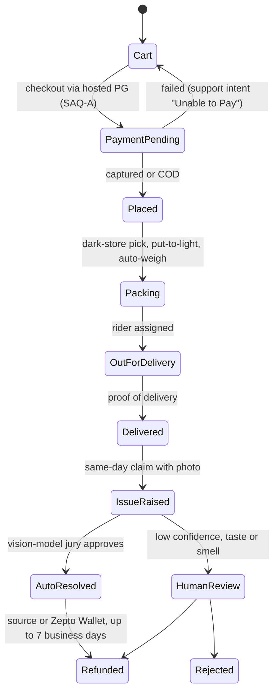

# REA Systems & Security Blueprint: Zepto

Evidence date: 24 Oct 2026 · Confidence: medium-high on customer handling, low on app internals ·
Method and labels: [README](README.md)

> **Verdict.** Zepto's real moat is not delivery speed; it is **photo-first, AI-adjudicated refunds
> with image forensics**, running at 100k+ tickets a day. Its edge is hardened (AWS WAF Bot Control),
> and its security programme is documented in its IPO filing. Its weak points are trust, not
> technology: a food-safety enforcement record, a dark-pattern penalty, no phone channel (which fake
> helplines exploit) and refunds that customers say get parked in Zepto Cash.

## 0. Target identity and coverage

| Item | Value | Evidence |
| --- | --- | --- |
| Entities | Zepto Ltd (IPO issuer); Zepto Marketplace Pvt Ltd (Play developer) | EV-ZEP-04, EV-ZEP-07 |
| Consumer app | `com.zeptoconsumerapp` (Android); Zepto Café has its own app since Dec 2024 | EV-ZEP-07 |
| Web origins | `www.zepto.com`, `www.zeptonow.com` behind CloudFront + AWS WAF; Next.js assets on `cdn.zeptonow.com` (build 17.5.1) | EV-ZEP-01, EV-ZEP-03 |
| Scale | 1,139 dark stores in 66 cities; about 2.33M orders a day (Jan-Mar 2026); median delivery 11.4 min (FY26) | EV-ZEP-04 |
| Model | Marketplace: Merchant Partners sell from Zepto-operated dark stores; Café kitchens run by merchants | EV-ZEP-04 |

### Investigation checklist

| Question | Status | Evidence |
| --- | --- | --- |
| Certificate pinning and MitM defence | **Unresolved** for the apps; web edge answered | EV-ZEP-01..03 |
| Session and token management | **Partial**: login methods known, token storage and rotation unknown | EV-ZEP-09 |
| Device and environment verification | **Partial**: declared signals known, enforcement logic unknown | EV-ZEP-07, EV-ZEP-02 |
| Order pipeline and state machine | **Partial**: customer-visible lifecycle only | EV-ZEP-04, EV-ZEP-08 |
| Refund and dispute automation | **Answered** | EV-ZEP-05, EV-ZEP-08 |
| Network edge cases (crash, offline, double charge) | **Unresolved**: nothing public | n/a |
| Support operations | **Answered** | EV-ZEP-04, EV-ZEP-05 |

## 1. Application security and attack surface

### 1.1 Certificate pinning and network protection

- **Observation:** both web origins return `HTTP/2 202` with `x-amzn-waf-action: challenge` from
  CloudFront to a plain HTTPS client (EV-ZEP-01).
- **Observation:** a stock headless Chromium received AWS WAF's `challenge.js` (681,267 bytes) from
  `*.token.awswaf.com`. It was given an `aws-waf-token` cookie (Secure, SameSite=Lax, readable by
  JavaScript because the WAF SDK refreshes it) and then **HTTP 429**. Bot Control escalates from
  challenge to rate-block rather than serving content (EV-ZEP-02).
- **Observation:** no `/.well-known/security.txt` (404) (EV-ZEP-03).
- **Documented:** TLS in transit, critical data encrypted at rest, a vulnerability-management
  programme with periodic scans, an external VA/PT in Feb 2026, and DR "aligned with ISO/IEC 27001".
  ISO 27001:2022 is "recommended" by TUV, which suggests the certificate was not yet issued at filing
  (EV-ZEP-04).
- **Unknown:** whether the Android and iOS apps pin certificates. Nothing public establishes it either
  way, and we did not decompile the app (see the authority boundary in the README).

### 1.2 Session and token management

- **Documented:** login is by phone number. Since 26 May 2025, Truecaller's SDK gives one-tap login
  that skips the OTP (EV-ZEP-09).
- **Inference:** one-tap login moves proof of number ownership to Truecaller's verified-number flow,
  in which the server verifies a signed profile payload. Account security is then as strong as that
  verification and the fallback OTP path.
- **Documented threat model:** the filing names credential stuffing and social engineering, and
  states MFA for internal access to personal data (EV-ZEP-04). No customer-facing 2FA is documented.
- **Signal only:** a researcher video claims an OTP-bypass bug that was reported through responsible
  disclosure. Unverified, single source.
- **Unknown:** token format, on-device storage (Keystore/Keychain), refresh rotation and server-side
  revocation.

### 1.3 Device and environment verification

- **Documented declaration:** Play Data safety lists device IDs, **installed apps**, phone number and
  location as collected for "fraud prevention, security and compliance" (EV-ZEP-07).
- **Inference:** an installed-apps inventory plus device IDs is device-fingerprint risk scoring. It
  can surface app cloners, automation tools and multi-account farms without a dedicated RASP SDK.
- **Observation (web):** AWS WAF Bot Control gates the web origin (EV-ZEP-02).
- **Documented (last mile):** rider identity is checked with database records, facial recognition and
  CCTV. Staff attendance uses OdinEye face authentication, and Route IQ rebuilds GPS paths for
  "rider behaviour analytics" (EV-ZEP-13).
- **Unknown:** Play Integrity / App Attest use, and root, jailbreak or emulator blocking in the
  consumer app.

## 2. Customer handling, reconciliation and fault tolerance

### 2.1 Order pipeline and state machine

The customer-visible lifecycle below is reconstructed from the Terms (EV-ZEP-08), the filing
(EV-ZEP-04) and the Databricks write-up (EV-ZEP-05). Internal states, the orchestration engine and
the locking strategy are not public.

- **Documented:** card data never touches Zepto (PCI SAQ-A; "working towards PCI DSS Level 1"), and
  Zepto indemnifies its processors for fraud chargebacks (EV-ZEP-04).
- **Documented:** warehouse automation (put-to-light sorting, linear sorters, automated weighing and
  packing) sits in the pick step, and 15.54% of FY26 orders were COD (EV-ZEP-04).
- **Company claim:** "we have not had instances of system outages related to our platform". Outages
  are admitted only for third-party support services (EV-ZEP-04).

### 2.2 Refund and dispute automation (gold standard)

- **Documented pipeline (EV-ZEP-05):**
  1. A router sends the ticket to a specialist agent: where-is-my-order, Missing, Expiry, Returns,
     Quality, Unable to Pay or General.
  2. The photo is checked for blur, brightness and OCR quality.
  3. Fraud checks run on the image: **deduplication, manipulation detection, screenshot detection and
     catalog-image misuse**.
  4. Semantic checks: the photo must match the ordered item and the stated reason, and **proof of
     delivery is validated**.
  5. A **jury of three vision models** auto-approves the claim or routes it to a human. Taste and
     smell complaints, which a photo cannot show, go down a separate path.
- **Operating metrics (vendor-published, not audited):** 100k+ tickets a day, more than 80%
  AI-managed with human oversight, 65% lower support cost, 4x faster resolution. 18-20% of traffic
  is sampled for evaluation, issues are detected within 4-6 minutes, and LLM judges are calibrated to
  80-90% agreement with humans (EV-ZEP-05).
- **Contract rules (EV-ZEP-08):** claims must be made on the delivery day with images, returns need
  unopened packaging, and refunds arrive within 7 business days "to the source account or in the
  Zepto Wallet as may be chosen by You". Merchant Partners bear quality and wrong-item refunds
  (EV-ZEP-04).
- **Refund-fraud defence:** image forensics plus delivery validation plus catalog matching, with
  "fraud detection rate" as a monitored metric (EV-ZEP-05). Disclosed fraud types include refund
  fraud, referral fraud, collusion between users and riders, and riders using fake documents
  (EV-ZEP-04).
- **Weak spot (signals):** customers report refunds landing in Zepto Cash by default, and claims
  refused because the order was "sealed" at handover (EV-ZEP-17).

### 2.3 Network edge cases (crash, offline, double charge)

- **Unknown:** no public material on idempotency keys, payment-status reconciliation or app-kill
  recovery.
- **Inference:** the "Unable to Pay" support intent (EV-ZEP-05) shows payment failures are common
  enough to have their own automated path, which implies a server-side payment-status lookup it can
  call.
- **Documented scale proxy:** lost COD cash fell from 0.12% to **0.03%** of order value year on year,
  with COD tracked on the rider platform (EV-ZEP-04).

### 2.4 Support operations

| Layer | What Zepto runs | Evidence |
| --- | --- | --- |
| Tier 0 | ZAP in-app chat and a self-service Help Centre; GenAI resolves status, refunds and photo disputes end to end | EV-ZEP-04, EV-ZEP-05 |
| Tier 1 | Humans in "One Support", an in-house CRM; agents see only non-personal data and can refund, return or call back | EV-ZEP-04 |
| Tier 2 | Grievance Officer (Panduranga Acharya, legal@zepto.com); acknowledge within 48 h, resolve within 30 days | EV-ZEP-04, EV-ZEP-08 |
| Channels missing | **No inbound phone line** | EV-ZEP-04 |

**Security consequence:** with no official phone channel, search-engine "Zepto helpline" scams fill
the gap. One customer chasing a ₹24 refund lost ₹87,000 (EV-ZEP-12). The customer-handling design
created the attack surface.

## 3. Trust, privacy and compliance

- **Store quality assurance (documented):** a 32-point hygiene and FSSAI audit per store,
  multi-zone cold-chain checks on inbound vehicles, CCTV audits of handling, a quarantine zone, and
  48,011 store staff moved onto Zepto's payroll "to help facilitate better control" (EV-ZEP-04).
- **Execution record:** Dharavi licence suspended (Jun 2025), Narsingi scored 30/60 for hygiene
  (Jul 2026), an FSSAI show-cause over expired besan (19 Oct 2026), and 21 pending regulatory
  actions (EV-ZEP-04, EV-ZEP-11).
- **Dark patterns:** a ₹7 lakh CCPA penalty for a pre-ticked Zepto Pass and the handling fee
  (Dec 2025), stayed by the consumer appeals court (NCDRC) on 20 Jan 2026 (EV-ZEP-10).
- **Privacy:** consent by use; installed-apps collection; a pseudonymised data partnership with The
  Trade Desk; "PMS" mood bundles. On DPDP, Zepto says it is still "identifying our obligations"
  (EV-ZEP-04, EV-ZEP-14).
- **Riders:** Zepto dropped "10-minute" branding after the Jan 2026 Labour Ministry meeting. It was
  criticised in Maharashtra over rider police verification. Insurance cover is up to ₹10 lakh for
  accidental death (EV-ZEP-15).
- **Vulnerability disclosure:** a policy covering the apps and web exists, reports go to
  security@zeptonow.com, there is **no bounty and no response SLA**, and there is no security.txt
  (EV-ZEP-06, EV-ZEP-03).

## 4. Best-in-market flows

| Flow | Mechanism | Why it works | Evidence |
| --- | --- | --- | --- |
| **AI refund adjudication with image forensics** | Specialist agents; image quality, dedup, manipulation and screenshot checks; catalog and proof-of-delivery matching; a three-model jury; evaluation gates on 18-20% sampled traffic | Every claim is checked against order, catalog and delivery data at machine speed. Cost falls 65% while abuse is filtered rather than waved through | EV-ZEP-05 |
| **COD and last-mile integrity** | COD reconciliation on the rider platform, GPS path rebuilding, face and CCTV identity checks | COD leakage of 0.03% of order value on a 15.5% COD mix | EV-ZEP-04, EV-ZEP-13 |
| **Edge bot defence** | AWS WAF Bot Control: JS challenge, then token, then 429 | Scrapers and credential-stuffing bots never reach the origin | EV-ZEP-02 |
| **Verified outbound identity** | Truecaller verified business caller ID and call reason | Customers can tell real Zepto calls from scams on outbound calls | EV-ZEP-09 |

## 5. Weak spots

1. No phone channel, which creates impersonation-scam exposure (EV-ZEP-12).
2. Refunds that default to the wallet, by signal, and strict evidence rules ("sealed" handover
   refusals) (EV-ZEP-17).
3. Food-safety enforcement that keeps recurring despite a documented audit system (EV-ZEP-11).
4. Dark-pattern and fee-transparency penalties (EV-ZEP-10).
5. A thin disclosure programme: no bounty, no SLA, no security.txt (EV-ZEP-06).
6. DPDP readiness not started on record, against a ~May 2027 deadline (EV-ZEP-04, EV-REG-01).

## 6. Residual unknowns

| Unknown | What would resolve it |
| --- | --- |
| App certificate pinning, token storage, root/emulator policy | Authorised static analysis of the shipped APK, which Zepto's terms do not grant us |
| Order orchestration engine, idempotency and locking | Zepto engineering publications; none found |
| SDK inventory | The Exodus report: its site served a decoy page aimed at AI scrapers, which we ignored and did not work around (EV-ZEP-16) |

## Evidence ledger

| ID | Type | Observation or claim | Source |
| --- | --- | --- | --- |
| EV-ZEP-01 | Live observation | `www.zepto.com` and `www.zeptonow.com` return 202 + `x-amzn-waf-action: challenge` (CloudFront) | curl, 2026-10-24T11:29Z |
| EV-ZEP-02 | Live observation | Headless Chromium: AWS WAF `challenge.js`, then the `aws-waf-token` cookie, then 429; local storage keys `aws_waf_referrer`, `awswaf_token_refresh_timestamp`, `aws_waf_token_challenge_attempts` | Playwright, 2026-10-24T11:31:40Z |
| EV-ZEP-03 | Live observation | `/.well-known/security.txt` 404; robots.txt disallows `/account*`, `/api/`, `/cart/`, `/order/`, `/ProcessOrder/` | curl, 2026-10-24 |
| EV-ZEP-04 | Company document | UDRHP-I: scale, security programme, fraud types, COD, support stack, grievance officer, regulatory actions | [1] |
| EV-ZEP-05 | Vendor case study | Multi-agent support, image forensics, three-model jury, metrics | [2] |
| EV-ZEP-06 | Company document | Responsible-disclosure policy: scope, no bounty, no SLA | [3] |
| EV-ZEP-07 | Store declaration | Play Data safety: device IDs, installed apps, location, photos; encrypted in transit; deletion on request | [4] |
| EV-ZEP-08 | Company document | Terms v1.5: same-day claims with images, 7 business days, source or wallet, 48 h / 30 days | [5] |
| EV-ZEP-09 | Reporting | Truecaller one-tap login and verified caller ID | [6] |
| EV-ZEP-10 | Reporting | CCPA ₹7 lakh dark-pattern penalty; NCDRC stay; Rajya Sabha reply | [7], [8] |
| EV-ZEP-11 | Reporting | Dharavi suspension; Narsingi 30/60; expired-besan notice | [9], [10], [11] |
| EV-ZEP-12 | Reporting | Fake-helpline scam: ₹87k lost over a ₹24 refund | [12] |
| EV-ZEP-13 | Company blog | Route IQ, OdinEye, open-box delivery | [13] |
| EV-ZEP-14 | Reporting | The Trade Desk data sharing; mood profiling | [14], [15] |
| EV-ZEP-15 | Reporting | "10-minute" branding dropped after the Labour Ministry meeting | [16] |
| EV-ZEP-16 | Third-party analysis | Exodus report unavailable (decoy page) | [17] |
| EV-ZEP-17 | Signals | Refunds held in Zepto Cash; "sealed" handover refusal | [18], [19] |

## Sources

1. [Zepto Ltd UDRHP-I](https://cdn.zeptonow.com/investors/documents/Zepto%20Limited%20-%20UDRHP-I.pdf), 8 Jun 2026
2. [Databricks: Evaluation-first AI agents: how Zepto scales customer support](https://www.databricks.com/blog/evaluation-first-ai-agents-how-zepto-scales-customer-support-databricks-and-mlflow), 9 Sep 2026
3. [Zepto responsible disclosure policy (Webflow copy)](https://zepto-landing-page.webflow.io/responsible-disclosure-policy), read 24 Oct 2026
4. [Google Play Data safety: com.zeptoconsumerapp](https://play.google.com/store/apps/datasafety?id=com.zeptoconsumerapp&hl=en_IN), read 24 Oct 2026
5. [Zepto Terms of Service v1.5 (Webflow copy)](https://zepto-landing-page.webflow.io/terms-of-service), 18 Dec 2024
6. [The Week / PTI: Truecaller partnership](https://www.theweek.in/wire-updates/business/2025/05/26/dcm74-truecaller.html), 26 May 2025
7. [MediaNama: Zepto fined ₹7 lakh over dark patterns](https://www.medianama.com/2025/12/223-zepto-fined-7-lakh-dark-patterns-ahead-ipo/), 6 Dec 2025
8. [Outlook Business: CCPA fines nine platforms](https://www.outlookbusiness.com/corporate/ccpa-fines-9-digital-platforms-including-zepto-indigo-over-dark-patterns), 5 Aug 2026
9. [Inc42: FDA suspends Dharavi licence](https://inc42.com/buzz/fda-suspends-zeptos-dharavi-warehouse-licence-for-food-safety-violations/), 2 Jun 2025
10. [Deccan Chronicle: Narsingi hygiene inspection](https://www.deccanchronicle.com/southern-states/telangana/cmc-food-safety-drive-finds-hygiene-violations-at-zepto-cancels-license-of-alsaba-1969721), 10 Jul 2026
11. [Inc42: FSSAI show-cause notices](https://inc42.com/buzz/fssai-crackdown-continues-with-fresh-show-cause-notices-issued-to-zepto-others/), 19 Oct 2026
12. [The420.in: ₹87,000 lost over a ₹24 refund](https://the420.in/ahmedabad-woman-loses-87000-cyber-scam-over-24-rupee-refund/), 8 Dec 2025
13. [Zepto TechXPress blog feed](https://blog.zepto.com/feed): Route IQ (24 Aug 2026), OdinEye (22 Jul 2026), open-box delivery (29 Sep 2026)
14. [MediaNama: Zepto shares user data with The Trade Desk](https://www.medianama.com/2025/06/223-zepto-shares-user-data-the-trade-desk-ads/), 19 Jun 2025
15. [MediaNama: profiling from PMS searches](https://www.medianama.com/2025/05/223-zepto-profiling-users-pms-searches/), 29 May 2025
16. [People Matters: 10-minute claims pulled back](https://www.peoplematters.in/news/business/blinkit-zepto-pull-back-10-minute-delivery-claims-after-govt-intervention-48019), 13 Jan 2026
17. [Exodus Privacy report: com.zeptoconsumerapp](https://reports.exodus-privacy.eu.org/en/reports/com.zeptoconsumerapp/latest/), unavailable 24 Oct 2026
18. [Voxya complaint: refund stuck in Zepto Cash](https://voxya.com/consumer-complaints/refund-amount-in-my-bank/267001), 19 May 2026 (signal)
19. [Curly Tales: refund refused after "sealed" handover](https://curlytales.com/they-promised-refund-now-refuse-it-zepto-customer-fails-to-get-refund-despite-alleged-scam-by-delivery-agent/amp/), 3 Jan 2025 (signal)
