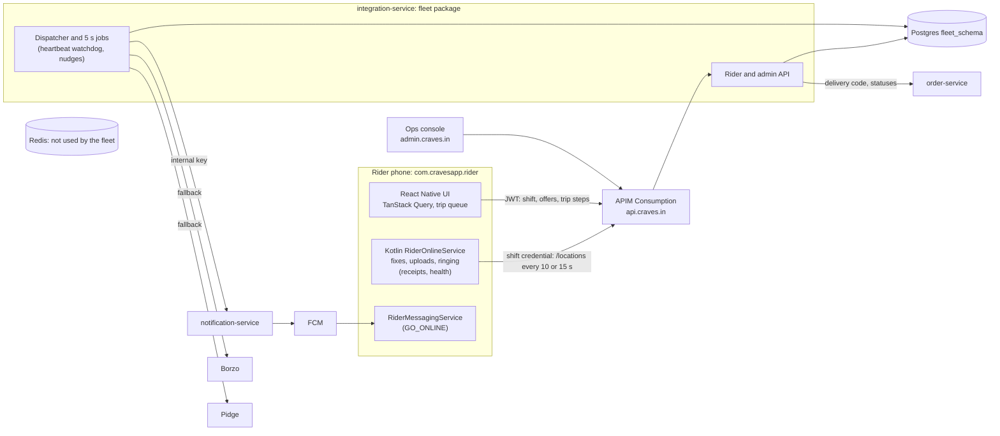
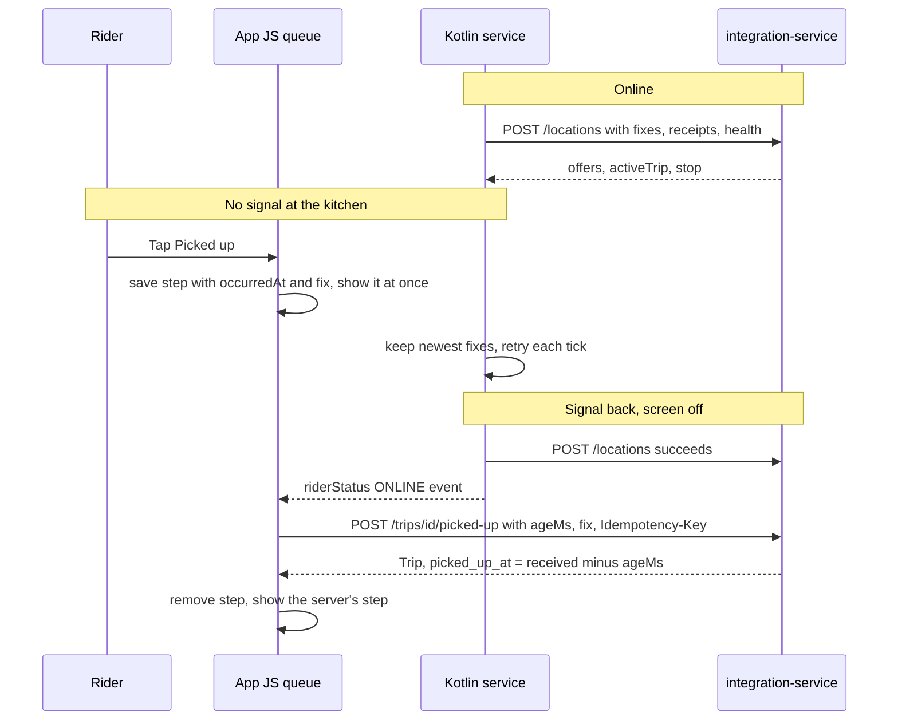
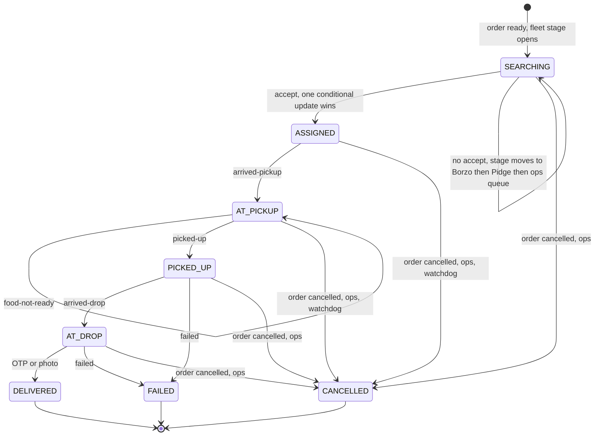

# Craves Rider: reliability blueprint

27 Oct 2026 · for Gopi · baseline `main` at `4c3e579` (#547)

**Status, 28 Oct:** Phase 1, the agent parts of Phase 2, and P3-03, P3-04 and P3-06's road-ranking switch are built; new behaviour is behind settings that are off. What was built, where it differs from this design, and what each person still does are in `WORKPLAN.md`'s Done notes and `GO-LIVE.md` §8. Code citations below are to the baseline.

A staff-engineer review of the rider app and fleet backend, with a plan in small PRs. Not a rewrite. Code claims cite `path:line` at the baseline; other claims are marked **[inference]**, **[estimate]** or **[unverified]**. Not legal advice: the lawyer and CA confirm items marked *legal*.

**Checked:** the rider JS and Kotlin code, the fleet package (`services/integration-service/src/main/java/in/craves/integration/fleet`), notification-service's push sender, both contracts, `docs/riders/*`, infra, CI, PR #545, and the project docs R4, R8 and RIDER-PLAYBOOK. The 17 rider Jest suites pass (269 tests). Two throwaway Jest tests reproduce two of A2's loss paths (not committed). The installed React Native 0.85.3 source was read for timers. **Not checked:** phones, a Gradle build, a local Java run (CI covers it, A10), production logs and data. Section 2 of the brief was empty and the phone-result tables are blank (`docs/riders/PHONE-TESTS.md:60-77`, `docs/riders/PERF.md:87-120`), so the findings come from the code.

## A. Findings

Ranked by harm to riders and orders. Fix IDs refer to section D.

**A1. A 90-second network gap at the kitchen can send the order to Borzo or Pidge while the rider holds the food.**
The watchdog hands back any trip the server still has as ASSIGNED or AT_PICKUP once `rider_position_latest.received_at` is 90 s old (`FleetDispatchJobs.java:57,127-172`). `received_at` moves only when a newer fix arrives (`FleetLocationService.java:67-72,118-121`), so a dead zone looks like a lost rider. If the rider tapped "Picked up" during the gap, that step is still queued on the phone and the server still says AT_PICKUP (`FleetTripService.java:65-67`). A second courier gets booked, the rider's trip ends with pay held, and the queued pickup later fails with 409. Fix: P1-01, P1-02.

**A2. Some offline steps are lost for good.**
- The delivery OTP is kept only in memory (`tripQueue.ts:23-24`). An app kill or reboot before sync forgets it, while the screen already shows "Trip complete" with "Saved · will sync" (`TripEnd.tsx:49,54`).
- Any 4xx other than 401, 408 or 429 drops every queued step of that trip (`offlineQueue.ts:118-126`; retries: `tripQueue.ts:13-18`, `core/http/requestPolicy.ts:9`). Replays can be refused through no fault of the rider:
  - a photo whose camera file was cleaned up is sent without the photo (`riderApi.live.ts:91-92`) and gets 422 `PHOTO_REQUIRED` (`FleetTripService.java:434-438`);
  - "Arrived at drop" and the photo, synced together later, get 422 `WAIT_NOT_OVER`, because the server times the door wait from the sync (`FleetTripService.java:171-174,418-424`);
  - a photo delivery retried after a lost response, once the file is gone, gets 422 even though the trip is already delivered, because the photo is checked before the replay and DELIVERED checks (`FleetTripService.java:243,250`).

The OTP and missing-photo paths were reproduced with the throwaway tests; the others are read from the code. Fix: P1-05, P1-07, P1-08, with P1-04 removing the false `WAIT_NOT_OVER`.

**A3. Queued steps sync only while the app is on screen.** The queue flushes on a 15 s `setInterval`, on foreground and at mount (`RiderRuntime.tsx:15,83-85`). React Native stops JS timers while the activity is paused: in react-native 0.85.3 `JavaTimerManager.kt` drops its frame callback in `onHostPause`, and the New Architecture runtime uses the same class (`ReactInstance.kt:139`). So with the screen off, the app swiped away, or Google Maps in front during navigation, nothing replays, though the Kotlin service keeps the process alive. Backoff can hold an entry 60 s after signal returns (`offlineQueue.ts:48-49`). After a restart the screen shows the server's older step, because the optimistic step lives in component state (`TripScreen.tsx:30,95`). Fix: P1-06, P1-08; P2-01 and P2-02 later.

**A4. Step times and places come from the sync, not the rider, and that changes pay.** The server stamps `arrived_kitchen_at`, `picked_up_at` and `arrived_drop_at` with `now()` (`FleetTripService.java:171-174`), checks the kitchen zone against the latest position at sync time (`FleetTripService.java:427-432`), and drops the `fix` the app sends with a delivery, since `StepBody` has no `fix` field (`FleetTripController.java:96-97`). Waiting pay runs from arrival (or chef-ready, if later) to pickup (`FleetTripPay.java:43-52`), so a pickup synced 20 minutes late overpays waiting, and a late "arrived" can lose the kitchen-zone credit. Fix: P1-04.

**A5. Nothing yet proves service survival or offer-to-ring, and today's data can't.**
- **Survival.** The pass rule is "no gap over 60 s in the backend's fixes" (`PHONE-TESTS.md:23`), but idle fixes overwrite one row per rider (`V152__fleet_schema.sql:333-343`), `trip_track` keeps only on-trip fixes (`FleetLocationService.java:122-128`), and uploads aren't logged.
- **Offer timing** lives only in phone logcat (`RiderOffers.kt:91,96`): JS drops the delivering channel (`riderOnlineService.ts:148-160`, `offerTiming.ts:3-7`), `trip_offer` has no delivery columns (`V152__fleet_schema.sql:276-295`), and the server logs only FCM's send result (`FleetDispatcher.java:323`).
- The test plan also names a column that doesn't exist, `rider_position_latest.updated_at` (`PHONE-TESTS.md:19`).

Fix: P1-09, P1-10, P1-15.

**A6. A live phone without a fresh fix drops out of dispatch, and phone clocks decide which fixes count.**
- **Fix freshness.** Eligibility needs a fix received in the last 45 s (`FleetDispatcher.java:58,247`). The documented heartbeat, an empty batch (`NATIVE.md:21`), writes nothing.
- **Phone clocks.** Fix time is the phone's `Location.time` (`RiderOnlineService.kt:143-145`). Fixes more than 5 minutes ahead of the database, or before the shift start, are dropped (`FleetLocationService.java:50,176-181`), so a fast clock silently ends dispatch for that rider.

BUILD-2026-10-20 accepted both as known behaviour, but each is cheap to fix. Fix: P1-01, P1-03.

**A7. After an OEM kill or a reboot, the rider believes they are online and nothing says otherwise.** A sticky restart can't start a location service from the background (`RiderOnlineService.kt:96-105`; R4 §2), the shift stays open up to 12 hours (`V152__fleet_schema.sql:219`), and there is no "tap to go online" push (BUILD decision 12). A cancelled trip also reaches only a running JS screen (`RiderOnlineService.kt:225-236`). Fix: P1-12, P1-13.

**A8. Location retention is unstated, and ops can see an off-shift rider's last position.** No job deletes `trip_track` partitions or `rider_position_latest` rows, `BACKEND.md` has no retention section, and the positions page lists every rider's latest fix from the last 12 hours, on shift or not (`FleetOpsService.java:147-162`). Rule 6 allows collection only while online, with a stated retention. Fix: P1-14.

**A9. Smaller problems that bite on cheap phones.**
- **Notifications off.** Offers can't ring if notifications are turned off mid-shift: `post()` logs and returns (`RiderOffers.kt:148-153`), and dispatch still picks the rider. Fix: P1-11.
- **Photo size.** Delivery photos upload at full resolution with JPEG quality 0.5 (`NotAnswering.tsx:68`), against a 60 s gateway timeout (`infra/apim/rider-fleet/upload-policy.xml:22`), so they are slow on 2G [inference]. Fix: P1-07.
- **Wake lock.** One partial wake lock is held for the whole shift, up to 12 h (`RiderOnlineService.kt:268-275,297`). Since 1 Mar 2026 Play treats non-exempt wake locks held 2 h or more with the screen off, in over 5% of sessions, as bad behaviour (store warning, less discovery); location callbacks are exempt, app-held locks are not [S2, S3]. Not a blocker for a side-loaded pilot. Fix before Play: P2-10.
- A token refresh while JS isn't running waits for the next app start (`RiderMessagingService.kt:20-23`): P1-13. Telugu and Hindi are 4-line stubs (`strings/te.ts`, `strings/hi.ts`) and native texts are English only (`RiderOffers.kt:37-39`): P2-08.
- The door "customer not answering" wait shows a countdown bar mid-trip (`NotAnswering.tsx:123`), which rule 7 doesn't allow: E5.

**A10. Checked and sound.**
- **CI already runs the Java database tests** (the brief is out of date): on every PR (`launch-regression-ci.yml:21`), with `LEDGER_TEST_JDBC_URL` set (`:113`), which the fleet database tests need; `mvn clean verify` for seven services (`scripts/launch/launch-regression.py:120`) fails on any skipped or missing test class (`:100-107`); green on #545 [unverified: per-class log].
- **R8's push fixes are in:** data-only, high priority, TTL = seconds left, a collapse key, the rider package (`RiderPushClient.java:59-69`, `RealtimePushSender.java:93-105`); dedupe by `offerId` and a visible notification whenever notifications are allowed (`RiderOffers.kt:83-102`).
- **Races:** one conditional UPDATE plus unique indexes pick one accept (`FleetTripService.java:93-131`, `V152__fleet_schema.sql:293-294`); cancel locks in the accept's order (`FleetTripService.java:326-337`); steps are idempotent by key (`V152__fleet_schema.sql:311-312`).
- **Gates:** `minAppVersion` blocks only between shifts (`gate.ts:15-25`, `FleetShiftService.java:88-89`); SOS is on every working screen (`RiderHeader.tsx:84`); the shift credential is hashed and accepted only on `/locations` and `/devices` (`infra/apim/rider-fleet/json-policy.xml:15`).

## B. High-level design

### B1. Topology (unchanged, with what Phase 1 adds in brackets)



Two channels reach the phone: FCM and the `/locations` response. Only the Kotlin service runs reliably with the screen off. Postgres holds all fleet state; one integration-service replica handles 200 riders (C3).

### B2. State and sync across online, offline and reconnect (after Phase 1)



The rules: (1) the server owns state, and a step's response is the truth; (2) the phone owns what the rider did and when, sent as `ageMs` and the fix at the tap, which the server uses within limits (C4); (3) each step goes once per idempotency key, in order per trip, and a refusal stays visible on the trip screen.

### B3. Security and location privacy

| Data | Where | Who sees it | Kept for (proposed; *legal* confirms) |
|---|---|---|---|
| Sign-in | MSG91 OTP, Firebase custom token, Craves exchange (`app/rider/useRiderSession.ts:68`) | nobody | session |
| Shift credential | app-private prefs (`RiderOnlineService.kt:321-332`); server keeps only its SHA-256 (`V152__fleet_schema.sql:206`) | nobody | ≤ 12 h |
| Phone binding | `rider_device` id = UUID of (rider, ANDROID_ID); the raw id isn't stored (`BACKEND.md` "Phones") | ops: model and state | while active |
| Latest position | `rider_position_latest` | ops, only for on-shift riders and live trips (P1-14) | until shift end (today: kept) |
| Trip track | `trip_track` day partitions | ops, per trip | 90 days (today: kept) |
| Selfie, delivery photo | private blob storage | ops | 30 / 90 days (P2-09) |
| Delivery OTP | phone only, encrypted, until the server answers (P1-05) | nobody | ≤ 24 h |
| Phone health | `rider_shift.health` (P1-10) | ops, engineering | 90 days |

Location is collected only while the foreground service runs, started by the Go Online tap; there is no background-location permission (`apps/mobile/android/app/src/rider/AndroidManifest.xml:3`). There is no Aadhaar step (decision of 19 Oct). DPDP duties start 13 May 2027; retention and the notice must be live first (P2-09).

## C. Low-level design (only what changes)

### C1. Offer delivery (question 1)

**Is FCM plus the location call enough?**
- **p99 ≤ 12 s holds by construction** for a phone whose service is alive: the next poll comes within one idle period (10 s) plus the round trip, and dispatch skips phones not heard from in 45 s.
- **p95 ≤ 5 s depends on FCM.** An offer that misses FCM waits 0–10 s for the poll plus about 1 s, so about 60% of those land after 5 s [estimate]. p95 ≤ 5 s needs FCM to ring within 5 s for about 92% of offers. Gojek measured about 90% for drivers (R8 E10): borderline, so measure it.

**Changes:**
1. **Receipts (P1-09).** The phone sends `offerId`, the first channel and `ageMs` since arrival (monotonic clock) on the next `/locations`. The server stores `rang_at = received − ageMs`, `rang_channel`, `pushed_at` and `push_result` on `trip_offer`. Offer-to-ring is `rang_at − offered_at`, all on the server clock.
2. **FCM Data API, weekly:** `deliveredNoDelay` and `priorityLowered` for the rider app [S7]. A rising `priorityLowered` means FCM is demoting offer pushes.
3. **Cadence knob, only if needed (P2-04).** If FCM rings on time for under 92% of 200+ offers on a brand, the server returns `nextPollSec` and idle polling drops to 5 s. Then only about 20% of FCM misses land after 5 s, so p95 holds with FCM as low as about 75% [estimate]. Cost: about 12M more gateway calls a month at 200 riders, about $40 at ~$3.50 per million [S10] [estimate], plus more radio wake-ups.

**Persistent channel (MQTT, SSE or WebSocket): not now.**
- **Fixes:** sub-second delivery while connected, and acks.
- **Costs here:** APIM Consumption can't carry WebSockets [S5], so either a fixed-fee v2 tier or a second public route that bypasses APIM with auth in the service. integration-service runs 0–2 replicas (`infra/prodlow-rebuild/main.bicep:115-119`) and would need a pinned replica and connection draining on every deploy. Container Apps itself supports WebSockets [S6].
- **Can't fix:** OEM kills; the socket dies with the process. Zomato, which runs MQTT in its delivery-partner app, wrote in June 2026 that "MQTT solved networking, not reliability"; OEM battery limits stay the hard part [S1].
- **Trigger:** after Phase 2, receipts still show p95 over 5 s with 5 s polling; or about 1,000 riders online (about 100 calls/s, about $400 a month in gateway calls) [estimate]. Then use a managed broker (Azure Web PubSub or Event Grid MQTT) and keep FCM as the fallback, as Gojek does (R8 E10) [inference].

### C2. Offline trip actions (question 2)

| Situation | JS queue today | JS queue after Phase 1 | Kotlin outbox (Phase 2) |
|---|---|---|---|
| Signal back, app on screen | sends within 15–75 s | sends within seconds | sends within seconds |
| Signal back, screen off | waits for the app to open | sends after the service's next good upload | sends |
| App swiped away, service alive | waits for the app to open | waits: no JS screen is listening | sends |
| OEM kills the process mid-trip | kept except the OTP; sent on next app open | all kept; sent on next app open | all kept; a persisted job sends on signal, if the OEM lets jobs run [unverified] |
| Reboot | as a kill | as a kill | the job runs after boot |
| Photo | URI of a camera cache file that can vanish, which loses the step | copied and shrunk into app storage | the same, owned by native code |
| OTP | in memory, so lost | encrypted with Keystore (`expo-secure-store`, already installed) | encrypted with a native Keystore key |

**Decision: yes, move trip actions into the Kotlin service, in Phase 2 (P2-01, P2-02).** Phase 1 closes every loss path in the JS queue with about five small PRs, which the pilot needs now. The native outbox needs the shift credential on trip routes; today the gateway strips it there (`infra/apim/rider-fleet/json-policy.xml:15`, `infra/apim/rider-fleet/upload-policy.xml:16`) and Spring allows it on two routes only (`BACKEND.md` "Shifts"). That security change is better made with pilot data. **Pull it forward if** the airplane-mode test loses any action, or receipts show a p95 sync delay over 5 minutes.

**Phase 1 storage.** AsyncStorage key `rider.queue.v2`, migrated from `v1` on first read:

```ts
interface QueueEntry {      // today's fields, plus:
  occurredAt: number;       // phone time of the tap; sent as ageMs = Date.now() - occurredAt
  fix?: RiderFix;           // the service's last fix at the tap
  otpRef?: string;          // the OTP lives in expo-secure-store as rider.otp.<id>, never in AsyncStorage
  photoPath?: string;       // the app-storage copy (P1-07), deleted after the answer
  refused?: RejectInfo;     // kept for the trip screen until the trip ends
}
```

**Phase 2 storage.** Two files in `filesDir/rider/`, written only by the service thread through the platform `AtomicFile` (write a new file, then rename):

```json
{"v":2,"entries":[{"id":"e1","key":"rider-picked-up-<trip>-<rider>","tripId":"<trip>","action":"picked-up",
  "body":{},"otpSealed":null,"photo":null,"wallMs":1761550000000,"elapsedMs":81234567,"boot":42,
  "attempts":0,"nextAt":0,"state":"PENDING"}]}
{"v":1,"fixes":[{"lat":17.44,"lng":78.39,"acc":12.0,"wallMs":1761550000000,"elapsedMs":81230000,"boot":42,"mock":false}]}
```

`AtomicFile` and JSON rather than Room or SQLite: tens of entries, atomic writes by rename, no new dependency [inference]. `boot` says whether `elapsedMs` is still comparable; if not, the server falls back to `wallMs`, within limits.

**Interfaces.** One JS interface; Phase 1 implements it on AsyncStorage, Phase 2 on the native module:

```ts
export interface TripActions {
  enqueue(input: NewQueueEntry): Promise<QueueOutcome>;
  pending(riderId: string, tripId?: string): Promise<QueueEntry[]>;
  subscribe(listener: () => void): () => void;
}
// Pure fold of the server step over pending entries; mirrors FleetTripService's STEPS table.
export function displayedStep(server: TripStep, pending: QueueEntry[]): TripStep;
```

```kotlin
// Phase 2: android/app/src/rider/java/com/cravesapp/RiderOutbox.kt
object RiderOutbox {
  fun enqueue(context: Context, action: OutboxAction): String       // durable before it returns
  fun pending(context: Context, tripId: String?): List<OutboxView>
  fun flush(context: Context, shift: RiderOnlineService.Shift)       // service thread only; in order per trip
}
```

**Patterns.** Used: an outbox with idempotency keys (what exists, finished); an explicit client step machine, `displayedStep`, folding over the server's own step table (`FleetTripService.java:65-67`); receipts carried on the heartbeat. Not added: a repository layer, since `RiderApi` with mock and live implementations already is one (`riderApi.ts:26-65`); a dispatch strategy, since one policy with off, shadow and live is enough.

### C3. Location (question 3)

| State | Priority | Fix every | Upload every |
|---|---|---|---|
| Waiting for offers | balanced | 10 s | 10 s |
| Accepted to delivered | high accuracy | 3 s | 15 s |

Unchanged (`RiderOnlineService.kt:152-167,293-296`); the batch delay equals the upload period, as R8 advises.

- **Clock skew (P1-03).** Each fix carries `ageMs` from `elapsedRealtimeNanos`; the server sets `recorded_at = received − ageMs`. Old APKs send only `at` and keep today's rule.
- **Mock.** Mock fixes are stored but never count for dispatch, the kitchen zone or in-zone pay (`FleetDispatcher.java:247`, `FleetLocationService.java:192-210`, `FleetTripService.java:427-432`). Keep it; Play Integrity (logged only) comes in Phase 2.
- **Offline fixes.** The newest 5, in memory, are enough for the pilot because pay uses road distance, not the track (`FleetDispatcher.java:213`, `FleetPay.java:56`). P2-03 keeps up to an hour on disk, thinned, for disputes.
- **Storage up to 200 riders: Postgres.** Ingest is at most 5 statements per call and load-tested to 20 calls/s (`BACKEND.md` "Statement budget", `FleetLocationApiDatabaseTest`), about 200 riders at 6 calls a minute. **Change when** load stays above 20 calls/s or p95 above 300 ms: batch more per call first, then move latest positions to Redis GEO (Managed Redis exists, `infra/prodlow-rebuild/main.bicep:303`). `trip_track` grows about 1M rows a day at 200 riders [estimate]; thin to one fix per 10 s after 7 days once it passes about 5 GB.
- **Retention (P1-14).** Delete the latest position at shift end, drop `trip_track` partitions after 90 days, show ops only on-shift riders and live trips, and write the periods into `BACKEND.md` and the privacy notice (*legal*).

### C4. Order lifecycle (question 4)



The server is the authority (`fleet_schema.trip.state`): every step moves `version`, is idempotent by `Idempotency-Key`, and gets 409 out of order. Statuses bridge to delivery statuses as in `BACKEND.md` "Trip steps and statuses" (`FleetStatusBridge.java:107-127`). The 3PL chain is unchanged: a handed-back order is booked with Borzo or Pidge with `handoffFromProviderId: craves_fleet` (`FleetDispatchJobs.java:247-338`).

**New rule for step times (P1-04):** `occurred = received − ageMs`, clamped between the previous step's time and `received`, at most 30 minutes back. It feeds the step columns, the waits and pay; the step's own non-mock fix, if under 2 minutes old at the tap, feeds the kitchen-zone check. Published delivery statuses keep the server's time. The fraud surface is small: the clamp, the stored track, and photo or failed endings already held for ops.

| Race | Today | After |
|---|---|---|
| Two accepts | one conditional UPDATE wins; the loser gets 409 `OFFER_TAKEN`; covered by `FleetOfferDatabaseTest` | no change |
| Accept against expiry | the server checks `expires_at` and the stage deadline, so a late accept gets 410; the phone counts down from its receive time | no change |
| Cancel during a trip | refund signal every 5 s (`FleetDispatchJobs.java:106-120`); the rider learns at the next upload; queued steps get 409 and are dropped | a notification from the service (P1-12); the refusal shown on the trip screen (P1-08) |
| Watchdog against an offline pickup | A1 | heartbeat, a longer window at the kitchen, ops confirms (P1-01, P1-02) |
| OTP entered offline | memory only; "Trip complete"; a later wrong code flips an open trip screen back to the code boxes, or, if the rider left it, shows nothing but Home's resume card (`RiderRuntime.tsx:78`, `TripScreen.tsx:47-56`) | stored encrypted; "Waiting to confirm"; a later wrong code goes to an ops check with pay held, never lost (E4) |
| Ops reassign against a rider step | ops ends the rider's trip under a row lock (`FleetOpsService.java:290-301`); the rider's step gets 409 | refusal shown in place |

### C5. Push and device (question 5)

| Channel | Importance | Used for |
|---|---|---|
| `rider_offers` (exists) | high, ringtone, vibration | offers, test ring |
| `rider_online` (exists) | low, ongoing | "You're online" |
| `rider_trip` (new, P1-12) | default | trip cancelled or reassigned; "Tap to go online" |

- **Channel IDs are fixed once created;** change the ID when a sound changes (R4).
- **Ringing.** Keep the channel sound. Android 17 silences app-played background audio unless the app has a visible activity or a foreground service (for API 37 targets, one with while-in-use rights) [S4]; a channel sound is played by the system [inference]. If over 20% of pilot offers expire unanswered, add `FLAG_INSISTENT` so the sound repeats until opened or timed out.
- **Notification permission.** Setup requires it (`PhoneSetupScreen.tsx:58`). P1-11 rechecks the app and channel every tick, warns the rider and sends `canRing:false`, so dispatch skips a phone that can't ring.
- **Token refresh.** The service posts a new token to `/devices` with the shift credential, which that route already accepts (P1-13).
- **Binding.** ANDROID_ID is per signing key (`RiderDeviceModule.kt:64-72`): it survives a reinstall or reboot and changes after a factory reset or with a new key. Never change the key (`RELEASE.md`).
- **After a reboot or force stop** the service doesn't return, by design. P1-13's server job finds open shifts silent for 3 minutes and sends one GO_ONLINE push (data, high priority, always a visible notification) at most every 30 minutes; the tap opens Home, which resumes the saved shift (`HomeScreen.tsx:127-131`). It goes only to app versions that handle it, because an old APK would get a high-priority push with no visible notification, which FCM penalises (R4 §3). A force-stopped app gets no FCM at all [inference], so ops' call is the fallback.

### C6. API changes (`contracts/openapi/rider-v1.yaml`)

All additions are optional, so installed APKs keep working; the server ships first. Set `minAppVersion` to the Phase 1 APK before dispatch goes live (it blocks only between shifts).

```diff
   /locations:
     post:
-      requestBody: {... properties: {fixes: {type: array, maxItems: 5, items: RiderFix}}}
+      requestBody: {... properties:
+        fixes: {type: array, maxItems: 5, items: RiderFix},
+        offerReceipts: {type: array, maxItems: 10, items: OfferReceipt},   # P1-09
+        health: DeviceHealth}                                             # P1-10, P1-11
   /trips/{tripId}/{action}:
     post:
       requestBody:
         application/json:
-          oneOf: [{method: OTP, otp, fix}, {reason, note}]
+          oneOf: [{method: OTP, otp, fix, ageMs, capturedOffline}, {reason, note, ageMs, fix}, {ageMs, fix}]   # P1-04, P1-05
         multipart/form-data:
-          properties: {method, callsMade, photo, fix}
+          properties: {method, callsMade, photo, fix, ageMs}               # fix and ageMs are read now
 components:
   schemas:
     RiderFix:
       properties:
+        ageMs: {type: integer, minimum: 0, maximum: 3600000}               # P1-03: server uses received - ageMs
+    OfferReceipt:
+      required: [offerId, channel, ageMs]
+      properties: {offerId: {type: string}, channel: {enum: [fcm, locations]}, ageMs: {type: integer, minimum: 0}}
+    DeviceHealth:
+      properties: {batteryPct: integer, charging: boolean, powerSave: boolean, canRing: boolean,
+                   lastExitReason: {type: string, maxLength: 40}, queuePending: integer, queueOldestAgeS: integer}
     LocationBatchResponse:
       properties:
+        nextPollSec: {type: integer, minimum: 5, maximum: 30}               # P2-04, only if needed
```

`admin-fleet-v1.yaml` gains read-only `lastSeenAt`, `maxSilenceSeconds`, `rangAt`, `rangChannel` and `pushResult`.

### C7. Batching and smarter routing (question 6): parked

- **Two orders per trip.** Trigger: for two weeks in one zone, at least 15% of orders have a second order from the same kitchen ready within 10 minutes with drops within 2 km, while riders are busy over 60% of their online time; below that, the next free rider or a 3PL is cheaper [inference]. Smallest design: an add-on offer to a rider already AT_PICKUP there, as a second trip row with its own pay (a trip row is one rider's pay record).
- **Road-ETA ranking.** Trigger: for over 20% of trips, the real pickup leg (from `trip_track`) is over 1.5 times the straight-line estimate. Smallest design: rank only the 3 nearest with the existing Ola client (`RoadDistanceClient.java`), 3 calls per order.
- Changing dispatch rules after go-live is an automated-system change: plan 14 days' notice (Act 21) (*legal*).
- **Built ahead, off (28 Oct):** road ranking behind `CRAVES_FLEET_ROAD_RANKING_ENABLED`, so the switch needs no release when its trigger fires. It ranks the 5 nearest by straight line and offers the 3 nearest by road: ranking only the 3 nearest would reorder riders who all get the offer at once (`WORKPLAN.md` P3-06).

### C8. Observability (question 7)

| Number | How it's computed | Where it lives | Who sees it | Target |
|---|---|---|---|---|
| Offer-to-ring | `rang_at − offered_at`, by channel and model | `trip_offer` (P1-09) | Gopi daily, in the console (P3-04) | p95 ≤ 5 s, p99 ≤ 12 s |
| FCM health | `deliveredNoDelay`, `priorityLowered` | FCM Data API [S7] | Gopi weekly | `priorityLowered` ≈ 0 |
| Service survival | per shift: last seen, longest silence, silences over 60 s; last exit reason (`ApplicationExitInfo`, no SDK) | `rider_shift` (P1-01, P1-10) | ops, Gopi | 4 h, no silence over 60 s |
| Queue age, lost actions | `ageMs` on each step; queue size and oldest age in health; refusals by code | `trip_event`, `rider_shift.health` | Gopi | p95 sync within 60 s of signal; 0 lost |
| Battery per online hour | battery drop per online hour, not charging | `rider_shift.health` | Gopi | recorded in Phase 1, target set in Phase 3 |
| Crash-free sessions | exit reasons CRASH and ANR per shift; Play vitals once on Play | `rider_shift`, Play Console | Gopi | ≥ 99.5% [proposed] |
| Dispatch fallback rate | fleet-stage outcomes: ACCEPTED vs NO_ACCEPT, RIDERS_BUSY, NO_RIDERS, COST_GUARD | `trip_stage` (exists) | ops, Gopi | check any zone over 50% with riders online |

Queries go in `services/integration-service/src/main/resources/fleet/pilot_health.sql` (first `scripts/riders/pilot_health.sql`) with a runbook, `docs/riders/PILOT-HEALTH.md` (P1-15); the console's Rider pilot health page runs them (P3-04). No new monitoring service.

## D. Phased roadmap

### Phase 1: pilot-ready reliability

**Entry criteria:** services deployed, dispatch off, a live APK from `main` and CI green. All are true on 27 Oct. `docs/riders/WORKPLAN.md` spells out every task below step by step, with the people steps.

Each row is one PR with tests and any flag off by default. Customer and chef apps are untouched. Each migration is additive, starting at V161 in merge order.

| ID | Change | Files | Proof |
|---|---|---|---|
| P1-01 | Heartbeat: each `/locations` call sets `rider_shift.last_seen_at`, longest silence and silences over 60 s, in the existing shift-row update. Eligibility: heartbeat ≤ 45 s and a non-mock fix ≤ 3 min. | migration, `FleetLocationService.java`, `FleetDispatcher.java`, `FleetOpsService.java`, `BACKEND.md` | `FleetLocationApiDatabaseTest`: an empty batch moves `last_seen_at`, within 5 statements. `FleetDispatchDatabaseTest`: a 2-min-old fix with a heartbeat is eligible; 46 s of silence is not. |
| P1-02 | Watchdog that doesn't strand food: ASSIGNED 90 s without heartbeat; AT_PICKUP alerts ops at 90 s, hands back at 300 s. | `FleetDispatchJobs.java` | `FleetDispatchJobsDatabaseTest`: AT_PICKUP silent 120 s alerts and keeps the trip; 301 s hands back; a heartbeat with no fix never triggers. |
| P1-03 | Clock-safe fixes (`ageMs`). | `RiderOnlineService.kt`, `rider-v1.yaml`, `contract.ts`, `FleetRiderModels.java`, `FleetLocationService.java`, `NATIVE.md` | `FleetLocationServiceTest`: a phone 10 min fast keeps its fixes with `ageMs`; without it, today's rule. |
| P1-04 | Steps record when and where (`ageMs`, `fix`, clamp; photo form fields read). | `FleetTripController.java`, `FleetTripService.java`, `rider-v1.yaml`, `contract.ts`, `riderApi.live.ts`, `TripScreen.tsx` | `FleetTripStepsDatabaseTest`: a late "arrived at drop" plus photo passes; `ageMs` over 30 min clamped; mock fix ignored. |
| P1-05 | OTP survives restarts, encrypted; "Waiting to confirm" instead of "Trip complete" (decision E1). | `tripQueue.ts`, `offlineQueue.ts`, `TripEnd.tsx`, `strings/en.ts`, `FleetTripService.java` | `offlineQueue.test.ts`: the OTP survives a new queue instance and never reaches AsyncStorage. |
| P1-06 | Show the step from the queue (`displayedStep`). | new `domain/tripSteps.ts`, `TripScreen.tsx` | `trip.test.tsx`: a restart with a pending "Picked up" opens on the to-customer step. |
| P1-07 | Keep the delivery photo: native `keepPhoto` copies it into app storage, long edge 1600 px; no photo-less replays; the server checks replay and DELIVERED before the photo. | `RiderDeviceModule.kt`, `riderDevice.ts`, `NotAnswering.tsx`, `riderApi.live.ts`, `FleetTripService.java` | `riderApi.live.test.ts`: a missing file is never sent; the entry asks for a retake. |
| P1-08 | Flush on the service's ONLINE event; reset backoff when an upload succeeds; show refusals on the trip screen. | `RiderRuntime.tsx`, `offlineQueue.ts`, `TripEnd.tsx` | `RiderRuntime.test.tsx`: an ONLINE event flushes past backoff. |
| P1-09 | Offer receipts and push results. | migration, `RiderOffers.kt`, `RiderOnlineService.kt`, `FleetDispatcher.java`, `FleetLocationService.java`, `rider-v1.yaml` | `FleetLocationApiDatabaseTest`: a receipt is stored once; another rider's offer is ignored. |
| P1-10 | Health once a minute and the last exit reason. | migration, `RiderOnlineService.kt`, `FleetLocationService.java`, `rider-v1.yaml` | DB test stores health; an old payload is unchanged. |
| P1-11 | Can't-ring guard: the service warns, and dispatch skips `canRing:false`. | `RiderOnlineService.kt`, `RiderOffers.kt`, `FleetDispatcher.java` | `FleetDispatchDatabaseTest`. |
| P1-12 | Trip cancelled or reassigned: a notification from the service on `rider_trip`. | `RiderOnlineService.kt`, `RiderOffers.kt`, `src/rider/res/values/strings.xml` | CI APK; phone test step. |
| P1-13 | "Tap to go online" job and GO_ONLINE handling; token refresh posted from Kotlin. | `FleetDispatchJobs.java`, `RiderPushClient.java`, `RiderMessagingService.kt` | `FleetDispatchJobsDatabaseTest`: one nudge per 30 min; none to ended shifts or old versions. |
| P1-14 | Retention: delete the latest position at shift end; drop `trip_track` partitions older than 90 days; ops sees on-shift riders only. | `FleetShiftService.java`, `FleetLocationService.java`, `FleetOpsService.java`, `BACKEND.md` | `FleetOpsDatabaseTest`: an off-shift rider isn't listed; an old partition is dropped. |
| P1-15 | Pilot health queries; test plans gain an airplane-mode trip test with a kill and a reboot, survival on 4 GB and 3 GB phones, battery per hour, 100 ms screen renders, and the right column name. | new `scripts/riders/pilot_health.sql`, new `docs/riders/PILOT-HEALTH.md`, `PHONE-TESTS.md`, `PERF.md` | a DB test runs the SQL on fixtures. |
| P1-16 | Pool 8 with one replica (decision E3). | runtime settings, `check-db-connection-budget.py` input | the budget script passes. |
| P1-17 | Door wait shows "You can leave at" a time, not a bar (decision E5). | `NotAnswering.tsx`, `strings/en.ts` | `trip.test.tsx`. |
| P1-18 | Release 1.1.0: `versionName` and `RIDER_APP_VERSION` together, checked in CI. | `build.gradle`, `riderConfig.ts`, `rider-apk.yml` | the APK workflow. |

**People steps:** (1) build the live APK from `main` after P1-03 to P1-13 and set `minAppVersion` to it; (2) run `PHONE-TESTS.md` and `PERF.md` on a 4 GB and a 3 GB phone, and the offer test on all five brands; (3) shadow for a day, reading `FLEET_SHADOW` and the pilot-health queries; (4) go live in one zone.

**Definition of done:**

| Measure | Target | Measured by |
|---|---|---|
| Cold start to Home | ≤ 2 s, release build, 4 GB phone | `PERF.md` §1 |
| Each screen renders | ≤ 100 ms, mid-range phone | `PERF.md` (added in P1-15) |
| Offer shows on screen | ≤ 300 ms after arrival | `PERF.md` §2 |
| Offer-to-ring | p95 ≤ 5 s, p99 ≤ 12 s over at least 100 offers | receipts (P1-09) |
| Online service, screen off | survives 4 h on both phones, no silence over 60 s | `rider_shift` (P1-01) |
| Earnings list, 200 rows | < 5% janky frames | `PERF.md` §3 |
| Airplane-mode trip test | zero lost actions, including a kill and a reboot | `PHONE-TESTS.md` (P1-15) |
| CI | database tests green on every PR | regression workflow (A10) |
| Shadow day | at least 20 real orders logged, no unexplained skips | `FLEET_SHADOW` lines |

### Phase 2: 50 to 200 riders

**Entry criteria:** Phase 1 done, and two weeks live in one zone with receipts.

| ID | Change |
|---|---|
| P2-01 | Shift credential on `/trips/{tripId}/{action}` for its own active trip: a Spring rule, an APIM policy for that route, updated `FleetShiftCredentialSecurityTest` and `test_rider_fleet_apim.py`. Security review. |
| P2-02 | Native outbox (C2): `AtomicFile` store, sealed OTP, photos in app storage, flush on signal and after each upload, a persisted job after a kill or reboot (photos via a user-initiated data-transfer job, R4 S55), one-time move of the AsyncStorage queue. |
| P2-03 | Unsent fixes on disk, thinned to one per 30 s for up to an hour; `maxItems` raised to 20. |
| P2-04 | Server-driven idle cadence (`nextPollSec`), only if C1's trigger fires. |
| P2-05 | Chef "handed over" (`order-service` `markHandedOver`) sent to integration-service. The watchdog never fires after it. |
| P2-06 | Ops tool gaps (BUILD decisions 9 and 10): pay adjustments, issue acknowledgement, unsent payout files, bank reversals, moving a held trip to another rider. |
| P2-07 | Play internal testing (`RELEASE.md`), in-app updates for Play installs, Play Integrity (logged only), Android vitals. |
| P2-08 | Telugu and Hindi for JS and native text, signed off by native speakers. |
| P2-09 | Blob retention (selfies 30 days, photos 90 days) and the DPDP notice, before 13 May 2027. |
| P2-10 | Replace the 12-hour wake lock with uploads driven by location callbacks and short timed locks, before any Play rollout. Compare battery on the same phones. |
| P2-11 | Thin `trip_track` to one fix per 10 s per trip after 7 days, only if it passes about 5 GB. |
| P2-12 | Open the trip after a restart without signal (found while writing P1-15). |

**Definition of done:**
- 50 riders online with zero lost actions over a week of receipts.
- p95 sync within 30 s of the signal returning, even with the app swiped away.
- Offer-to-ring targets held.
- Retention jobs running.
- On the Play internal track with Telugu and Hindi.

### Phase 3: efficiency

**Entry criteria:** Phase 2 done.

Set a battery-per-online-hour target from Phase 1–2 data and meet it on a 4 GB and a 3 GB phone; keep cold start within 2 s and add a CI alert on APK growth (DoorDash, R8 E5); build a "Pilot health" console page on the P1-15 queries; batching and road-ETA ranking only if C7's triggers fire. **Done when** the battery target is met and the page replaces the manual queries.

## E. Risks and open decisions for Gopi

1. **The OTP at rest.** **Recommended:** keep it encrypted with a Keystore key until the server answers, at most 24 hours (this reverses an earlier review fix). Alternative: memory only, and the rider waits at the door for signal.
2. **Watchdog windows (P1-02).** **Recommended:** ASSIGNED hands back after 90 s with no heartbeat; at the kitchen, alert ops at 90 s and hand back at 300 s. Settle them before dispatch goes live and put them in the terms; later changes need 14 days' notice (*legal*).
3. **Pool size (BUILD decision 1).** **Recommended:** 8 connections, at most one replica. Two replicas also work; the jobs already tolerate them.
4. **An offline OTP the server rejects later.** **Recommended:** an ops check queue with the pay held, not lost; a person decides, with no automatic penalty (Act 21).
5. **The door wait countdown (rule 7).** **Recommended:** show "You can leave at 12:42" with no bar, or add this timer to rule 7's exception.
6. **Retention periods.** **Recommended:** latest position until shift end; trip track, delivery photos and health 90 days; selfies 30 days (*legal*).
7. **Persistent channel.** **Recommended:** not now; use the cadence knob first (trigger in C1).
8. **Distribution for the live pilot.** **Recommended:** Play internal testing (the playbook's choice); it also gives crash, ANR and wake-lock vitals with no SDK, so no Crashlytics.

**Top risks:** OEM kills on Xiaomi and Oppo (phone setup and P1-13; measured by P1-01 and P1-10); FCM demotion (a visible notification every time; watch `priorityLowered`); low order volume, which idles riders and makes the slot guarantee expensive (not an engineering fix; watch the fallback rate); dispatch-rule changes after go-live, each needing notice (*legal*).

## F. Sources

**Project docs:**
- `rider-app/research/R4-fleet-software-android.md`
- `rider-app/research/R8-rider-app-engineering.md` (E5, E10 and others)
- `rider-app/RIDER-PLAYBOOK.md`
- `rider-app/BUILD-2026-10-20.md`
- `rider-app/DEPLOY-NOW-2026-10-24.md`
- `rider-app/GO-LIVE-2026-10-22.md`

**Code:** every path above, at `4c3e579`.
- React Native 0.85.3, installed from `apps/mobile/package-lock.json`: `ReactAndroid/src/main/java/com/facebook/react/modules/core/JavaTimerManager.kt` and `runtime/ReactInstance.kt`.

**Web (opened 27 Oct 2026):**
- S1 Eternal (Zomato), Pulse-MQTT (23 Jun 2026): https://www.eternal.com/blog/pulse
- S2 Android Developers, Excessive partial wake locks: https://developer.android.com/google/play/vitals/excessive-wakelock
- S3 Android Developers Blog, battery technical quality enforcement (4 Mar 2026): https://android-developers.googleblog.com/2026/03/battery-technical-quality-enforcement.html
- S4 Android 17 background audio hardening: https://developer.android.com/about/versions/17/changes/bg-audio
- S5 Azure APIM, WebSocket APIs (not in Consumption): https://learn.microsoft.com/en-us/azure/api-management/websocket-api
- S6 Azure Container Apps ingress: https://learn.microsoft.com/azure/container-apps/ingress-overview
- S7 Firebase, Understanding message delivery: https://firebase.google.com/docs/cloud-messaging/understand-delivery
- S8 Android foreground service changes by version: https://developer.android.com/develop/background-work/services/fgs/changes
- S9 Azure API Management pricing (1M Consumption calls free per subscription): https://azure.microsoft.com/en-us/pricing/details/api-management/
- S10 Zuplo, API gateway pricing 2026 (~$3.50 per million Consumption calls) [single source]: https://zuplo.com/learning-center/api-gateway-pricing-comparison-2026.md

**Indian peers.** Searches found no engineering write-ups for Swiggy after 2019 (R8 E1), Zepto or Rapido. Zomato's S1 is the only new one.
