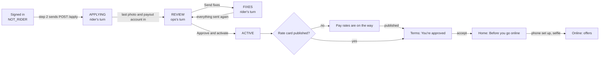
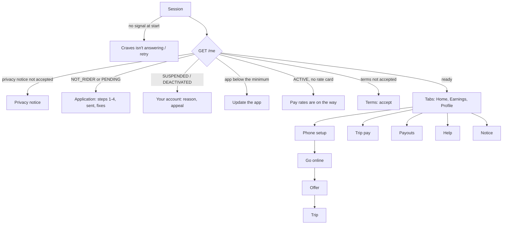

# Rider and ops flows

How a rider gets from signing in to getting paid, and what ops does at each point. For every flow: who acts, on which
screen, with what data, through which API, what changes in the database, what each side sees, what comes next, and what
happens when something goes wrong. The endpoints are in `BACKEND.md` and the contracts (`rider-v1.yaml`,
`admin-fleet-v1.yaml`); this file is the path through them.

**The rule behind it all: one application, one decision.** A rider applies once, in four steps, in the app. Ops checks
everything on one page and presses one button: approve, or send the fixes back. The rider always sees whose turn it is
and what happens next; so does ops.

## 1. The journey

| # | Who | Where | What happens | Next |
|---|---|---|---|---|
| 1 | Rider | App: phone number, then the SMS code (filled in from the SMS with one tap on Allow) | Signs in. `GET /me` says `NOT_RIDER` (no rider row) | The application, step 1 |
| 2 | Rider | App: Apply to ride, steps 1 to 4 | About you, the vehicle (sends the sign-up), the document photos, the payout account | "Application sent" |
| 3 | Ops | Console: Riders → To review → the rider | Checks each photo and the payout account, then one press | Approved (5), or fixes (4) |
| 4 | Rider | App: "Fix N things to go on" | Sends again only what ops sent back | Back to 3 ("Sent again") |
| 5 | Rider | App, on its own | The decision arrives as a push (a notice if the app is closed; the app also checks every 15 seconds and on returning): pay rates, then the terms with "You're approved" | Phone setup opens by itself, then Home |
| 6 | Rider | App: Home → "Before you go online" | Phone setup, then Go online with a selfie | Offers ring |
| 7 | Rider | App: offer, then the trip | Accept, kitchen, pickup, drop, code | Pay credited |
| 8 | Rider, ops | App: Earnings, Payouts. Console: Rider payouts | Pay is withdrawable 24 hours after a trip; paid every Monday, or withdrawn once a day | |

## 2. Where a rider stands: one rule, three places

The stage is worked out from the rider's documents and payout account, never stored, by the same rule on the server
(`FleetAdminService.SUMMARY`), in the console (the server's `stage`) and in the app (`domain/application.ts`). So the app
and the console never disagree about whose turn it is. No migration was needed.

| Stage | When (for a PENDING rider) | Whose turn | Rider sees | Ops sees (Riders tab, next step) |
|---|---|---|---|---|
| none | No rider row (`/me` says `NOT_RIDER`) | Rider | Apply to ride, step 1 | Nothing |
| `APPLYING` | A required photo was never sent, or no payout account is in (none sent, none set aside) | Rider | The application at the first step not done | Applying: "Rider still to send: 2 documents, payout account" |
| `FIXES` | A required photo's latest copy was not accepted or has expired, or the payout account was set aside | Rider | "Fix N things to go on", only those things | Fixes asked: "Rider is fixing: 1 document, payout account" |
| `REVIEW` | Everything is in | Ops | "Application sent", with the timeline | To review: "Review the application · waiting 3 h" |
| `ACTIVE`, `SUSPENDED`, `DEACTIVATED` | The rider's status | | The work screens, or the account screen | Active, Paused, Closed |

Checks go in this order: anything missing is `APPLYING` even if something else was sent back.

**Required photos** (`FleetRules.REQUIRED_DOCUMENTS`; the app's codes in brackets). A rider ops added without a vehicle
kind sends the petrol set.

| Vehicle | Photos |
|---|---|
| Petrol bike or scooter | Driving licence (DL), Vehicle RC (RC), Vehicle insurance (INSURANCE), PUC certificate (PUC), PAN card (PAN), Bank proof (BANK) |
| Electric bike or scooter | The same without PUC |
| Bicycle | PAN card, Bank proof |

## 3. The application (rider)

Header "Apply to ride", the 4-step bar ("Step 2 of 4: Your vehicle" for TalkBack), "Step N of 4" over the step's name.
The footer holds the step's one button and Back (Sign out on step 1); Android's back button goes to the previous step,
except while SOS or the demo panel is open above. Every step ends with Call support. A rider who leaves and comes back
starts at the first step not done: the photos while any is missing or sent back, else the payout account.

| Step | The rider gives | Checked in the app | API, data | Fails with | Next |
|---|---|---|---|---|---|
| 1 About you | Full name as on the PAN card, app language, 18 or older | Name of 2 or more letters; the box ticked | Nothing sent yet | The field says what is missing | Step 2 |
| 2 Your vehicle | What they ride; for a motor vehicle the number plate and, optionally, the make and model ("Honda Activa 6G") | The plate as the server checks it (`TS09EA1234`, `22BH1234AB`) | `POST /apply` `{name, language, vehicleKind, vehicleRegNumber, vehicleModel?, adult}` → a PENDING `fleet_schema.rider` row; the make and model is its `vehicle_label` | 409 `PHONE_IN_USE`; 400 `VALIDATION_FAILED` (plate, make and model) | Step 3. The screen lists the photos this vehicle needs. |
| 3 Document photos | A photo of each required document, from the back camera or the gallery | All sent before Next (the locked button says "Send all 6 photos to go on") | `POST /documents` multipart `type`, `photo` (JPEG or PNG; the server checks the bytes match) → a `rider_document` row, `PENDING` | 422 `DOCUMENT_FILE_INVALID` under the photo; no camera permission: Open settings | Step 4 |
| 4 Payout account | UPI ID, or account number and IFSC, in their own name | UPI or account format, holder name | `POST /payout-account` → `rider_payout_account` `SUBMITTED`, encrypted | 422 `HOLDER_NAME_MISMATCH`; 409 `PAYOUT_ACCOUNT_NOT_UNIQUE` | "Application sent" |

Step 3, each photo: "Not sent" with Add photo; "Sent" with Change photo; "Not accepted" with ops's reason and Send a new
photo; "Accepted". A gallery photo is saved again as JPEG (PNG stays PNG), the formats the server takes. The tips banner
says how to take one that passes: flat, good light, four corners, no glare, the original.

**Corrections.** Until ops approves, Back on the steps (or Change details once sent) sends `POST /apply` again: an empty
plate keeps the one on file, an empty make and model keeps the one on file (a new vehicle kind takes the kind's name). A
new name sets aside a payout account sent in the old one, so the rider sends it again (the app warns before saving).
Once ops accepted the PAN, licence or bank proof, or confirmed the account, a new name is 422 `NAME_LOCKED`; once ops
accepted the RC, another vehicle is 422 `VEHICLE_LOCKED`. The app shows the server's words and keeps the form open.

**Added by ops.** A rider ops added at the office (console, Add rider) signs in with that phone; `/me` links them and
they land on step 3 with their details already on file.

## 4. Waiting, fixes and approval (rider)

**Application sent** (`REVIEW`). "Ops checks every application by hand, usually within a day. You don't need to do
anything now; the result shows here." A timeline: Application sent (done), Ops checks your documents (now, "usually
within a day"), You're approved (next: "Then you accept your pay terms, set up your phone and go online"). Check now asks
at once; ops's decision arrives as a push (P6-04: type ACCOUNT to the phone the rider applied on, registered by
`POST /devices` once they have applied), and the app also asks every 15 seconds while open and whenever the rider comes
back to it (`GET /me`, `GET /profile`). With notifications off, a card asks to turn them on, so a closed app shows the
decision as a notice ("You're approved. Open Craves Rider for your next step.").
Below: what was sent (each "Checking"), the details (Change details) and the payout account (Change account). Footer:
Call support, Sign out.

**Fixes asked** (`FIXES`). "Fix 2 things to go on. Ops checked your application and needs these again. Everything else
is fine." Only the things to fix: each photo with ops's reason and Send a new photo, and the payout account form when it
was set aside ("Send your payout account again. It must be in your name and match your bank proof."). After each one:
"Sent. Ops checks it again." When the last is in, the screen is "Application sent" with "Sent again. Ops checks it next,
usually within a day."

**Approved.** The app moves on by itself when `/me` says `ACTIVE`:

1. No rate card published yet: "Pay rates are on the way" with a timeline (sent, approved, pay rates for your area) and
   Check again; asked every 15 seconds. Ops was warned on approval.
2. Terms to accept, topped with "You're approved. One last step before your first order: read how you are paid, then
   accept." (`POST /terms/accept`).
3. Phone setup opens by itself right after the first terms are accepted; Done (or back) lands on Home with "Before you
   go online": Application approved, Pay terms accepted (done), Set up your phone (Phone setup), Go online. It shows
   whenever location or notifications are missing, after the phone was checked once.

## 5. Ops: the queue and one decision (console)

**Where it is.** The console's sidebar has a Riders & fleet group, in the order ops works: Riders (start here), Go-online
selfies, Rider support, Fleet trips & dispatch, Rider payouts, Rider slots & banner, Rider pilot setup, Rider pilot
health. The admin overview shows, under the chef box, "Riders are waiting for you": applications to review, selfies to
check, rider problems open and SOS presses this week, each a link to its page (hidden for an admin with no rider role).

**Riders** (`/admin/riders`). Tabs with counts: To review (opens first), Fixes asked, Applying, Active, Paused, Closed,
All riders (`GET /riders?stage=` answers the counts per stage). Columns: rider, phone, stage, next step (a link for
To review), joined. Search by name or the phone's last digits. Add rider is only for someone at the office who can't
apply in the app; they sign in with that phone and finish the application there.

**One rider** (`/admin/riders/{id}`). For an applying rider, the review page:

| Item | What ops checks | Marks |
|---|---|---|
| About the rider | Name, phone, language, joined | |
| Vehicle | Kind, make and model, plate | Correct the vehicle (`PUT /riders/{id}/vehicle`), only if the RC shows something else |
| Each required photo | Open photo; what to compare is written under it ("Plate and make match the vehicle above, not expired") | Looks good, with the expiry date printed on it for the licence, RC, insurance and PUC; or Needs a fix, with a reason (five ready reasons written for the rider, or typed) |
| Payout account | Name, account and IFSC against the bank proof | Confirm, or Return (the rider sends it again) |

The decision bar stays at the bottom with one button at a time:

- **Approve and activate**, once every photo is marked Looks good and the account Confirm. Blockers are listed in words
  ("Waiting for the rider to send: Bank proof.", "Mark PAN card."). It asks once: "Approve Ravi Kumar? They become an
  active rider and can go online."
- **Send N fixes to the rider**, as soon as anything is marked Needs a fix.

One press sends `POST /riders/{id}/application/decision`
`{decision: APPROVE|FIXES, documents: [{documentId, verdict: OK|FIX, expiresOn?, reason?}], payoutAccount?: CONFIRM|RETURN, applicationVersion}`
with an `Idempotency-Key`. `applicationVersion` comes with the page (the rider's name, vehicle and sent payout account as
shown), so a decision only ever applies to what ops saw; each verdict names its photo the same way. In one transaction,
with one audit row (`APPLICATION_APPROVED` or `APPLICATION_FIXES_ASKED`):

| Approve | Fixes |
|---|---|
| Each photo VERIFIED with its expiry | The OK photos VERIFIED, the others REJECTED with the reason the rider sees |
| The account `SUBMITTED` → `ACTIVE` (payments or platform admins) | The account returned: `SUBMITTED` → `REPLACED` |
| Checks nothing is still needed (422 `APPLICATION_INCOMPLETE` names what is) | |
| While test mode is on, the rider joins the pilot riders (`test_mode_rider`), so offers can reach them | |
| A `RESTORE` status event ("Application approved"): status `ACTIVE`, the RIDER role granted in auth-service last | |

Afterwards: "Ravi Kumar is an active rider", what was done, whether they are on the pilot riders, and what the rider does
next; or, with no rate card published, a warning with a link to Rider pilot setup.

| Answer | Means | Ops sees under the buttons |
|---|---|---|
| 409 `APPLICATION_NOT_PENDING` | Someone else decided already | "This rider is not applying any more. Refresh the page." |
| 409 `APPLICATION_CHANGED` | The rider changed their details or sent another payout account while ops checked | "The rider changed their details or payout account while you were checking. Refresh the page." |
| 409 `DOCUMENT_REPLACED`, `DOCUMENT_NOT_PENDING` | The rider sent a newer photo meanwhile, or it was already checked | "The rider sent a newer photo of this document. Refresh the page." |
| 422 `APPLICATION_INCOMPLETE` | Something is still needed | "Still needed before approval: Bank proof." |
| 422 `DOCUMENT_EXPIRED`, `EXPIRY_REQUIRED` | An expiry before today, or none for a dated document | The page asks for the date before sending, and says an expired one needs a fix |
| 422 `FIXES_IN_APPROVAL`, `NO_FIXES` | Approve with a fix marked, or fixes with none | The page never sends these |
| 403 `PAYMENTS_ADMIN_REQUIRED` | Confirming an account needs a platform admin, or an operations admin who is also a payments admin | "Only a platform admin, or an operations admin who is also a payments admin, can confirm a payout account. Ask one to approve. To send fixes now, leave the payout account unmarked." |

A retry of the same press keeps its `Idempotency-Key`, so a lost answer never decides twice. Who: operations and
platform admins decide; confirming the payout account also needs payments or platform.

For a rider past the application the page is as before: documents (renewals), phones, the payout account, status
changes, shifts and recent offers; and a warning if test mode is on and they are not on the pilot riders.

## 6. After approval: online, offers and the trip

| Rider does | Screen | API | Data | Ops sees | Fails with |
|---|---|---|---|---|---|
| Sets up the phone | Phone setup: six checks for their phone brand | None (Android settings) | On the phone | Shift health on the rider page | Location and notifications block going online |
| Goes online | Go online: front-camera selfie | `POST /devices`, then `POST /shift/start` | `rider_shift` with its credential; the selfie | Selfie review (`/admin/riders/selfies`) | 403 `RIDER_NOT_ACTIVE`, `APP_UPDATE_REQUIRED`, `DOCUMENTS_EXPIRED`; 409 `DEVICE_NOT_BOUND` (ops approves the new phone), `SHIFT_OPEN`; 422 `SELFIE_INVALID` |
| Gets an offer | Offer: locked pay, distances, why it came, the countdown | `POST /locations` answers offers | `trip_offer` | Recent offers, Fleet trips | Expired, taken |
| Accepts | | `POST /offers/{id}/accept` | `trip` `ASSIGNED` | Fleet trips | 409 `OFFER_TAKEN`, `ORDER_CANCELLED`; 410 `OFFER_EXPIRED` |
| Rides the trip | Trip: to kitchen, at kitchen, picked up, at drop | `POST /trips/{id}/{action}` | `trip`, `trip_event`; the customer and chef see each status | Fleet trips | 409 `STEP_CONFLICT`, `TRIP_NOT_ACTIVE`; steps queue offline |
| Delivers | The customer's 4-digit code, or a photo after two calls and the wait | `delivered` | Pay lines on the trip | Delivery codes to check | 422 `OTP_INVALID` (tries left), 423 `OTP_LOCKED` → photo |

Test mode: dispatch offers trips only to pilot riders and kitchens. Approval adds the rider; kitchens are added in Rider
pilot setup.

## 7. Earnings and payouts

| Step | Rider sees | Ops does | Data |
|---|---|---|---|
| A trip ends with pay | Earnings: the trip with its pay lines | Can hold it (one hold a trip, up to 7 days) or adjust a line with a reason | `rider_earning` and a balanced journal |
| 24 hours later | It counts towards the withdrawable balance | | |
| Monday | Payouts: "paid Monday by 3 pm", then the UTR | Rider payouts: make the WEEKLY file, a second admin approves, upload once, mark sent, enter UTRs | `rider_payout_batch`, `rider_payout_instruction` |
| Any day | Withdraw: once a day, free, up to the balance | The next morning's DAILY_WITHDRAWAL file | |
| A payout fails or bounces | FAILED with the bank's reason; the money stays in the balance | Marks it failed or reversed; sets a new account with the rider | The account pauses until then |

The money flow is in `BACKEND.md` "Money".

## 8. Account changes after activation

| Change | Ops does | Rider sees |
|---|---|---|
| Safety pause | Status change `SAFETY_PAUSE`, review within 72 hours | "Your account is paused", the reason, how to appeal |
| Notice | `NOTICE`, 7 days to reply | The notice on Home; work goes on |
| Back to work | `RESTORE` | The work screens |
| Close | `DEACTIVATE`, only after a pause or a passed notice | "Your account is closed"; earnings still paid |
| A document expires | Reviews the renewal on the rider page | Profile: Expires soon, then Upload a new photo; Go online says which expired |
| App too old | Sets the minimum version | "Update the app to continue" between shifts |

## 9. Screens and navigation (app)

`RiderNavigator` decides the first screen from `GET /me`, in this order, and moves on by itself when `/me` changes:

A rider online or on a trip is never stopped by a new app version, terms or notice until the shift ends. SOS is in every
header.

**Signing in.** The number field keeps the 10 digits of whatever arrives (typed, pasted, or autofilled with +91, a 0 or
spaces), and Send code asks auth-service (`POST /api/v1/auth/otp/send`), which sends the SMS by MSG91; the code goes to
`POST /api/v1/auth/otp/verify`. On the code screen, Android's SMS User Consent API (Google Play services,
`RiderSmsCodeModule`) waits up to 5 minutes for the SMS: when it comes, Android asks in its own sheet whether Craves Rider
may read that one message, and Allow fills in the code. The sixth digit checks the code by itself, also typed or pasted (a
whole SMS works); Verify stays for a retry. Deny, a phone without Play services, or 5 minutes without the SMS: the rider
types it, as before. Resend waits for the new SMS. The app asks for no SMS permission and MSG91's template stays as it is
(the no-tap SMS Retriever API would need the app's hash in the message). The customer app reads its code through Firebase
phone auth instead, which the rider app does not use.

**The way back on every screen.**

| Screen | Back (header and phone) | Other ways out |
|---|---|---|
| Phone | The phone's Back leaves the app | Send code |
| Code | Back to Phone, as Change number does | The sixth digit verifies; Verify, for a retry; Resend |
| Privacy notice, application, Your account, Update, Pay rates on the way, Terms to accept | None in the header: the app opens these by itself, one at a time; the phone's Back steps back through the application's steps | Each one's own button; Sign out |
| Terms read from Profile, Help, Trip pay, Payouts, Notice | Back to where the rider came from | |
| Phone setup | Back to where the rider came from | Done, once location and notifications are on |
| Go online (selfie) | Back to Home | The shutter: Home, online at once |
| Offer | None while it is live, like an incoming call: an offer can't be opened again | Accept (to the trip) or Decline (free, back to Home); an ended offer closes itself after 2 s, or with Back |
| Trip | The phone's Back leaves the screen; the trip stays active (Home: Resume trip) | Each step's button; Customer not answering |
| SOS | Close | Call ops, Call 112 |

Going offline asks first ("Go offline?" or, on a trip, "Go offline during a trip?"), with Stay online as the safe answer.
A break and heading home start only between trips. Check now and Check again say "Checked at 4:09 pm" when nothing changed, or why they couldn't check.

## 10. API and data map

| Flow | Rider API | Admin API | Tables |
|---|---|---|---|
| Sign-up, corrections | `GET /me`, `POST /apply` | `POST /riders` (office) | `rider` |
| Photos | `GET /profile`, `POST /documents` | `GET /riders/{id}`, `.../documents/{docId}/content` | `rider_document` |
| Payout account | `POST /payout-account` | `PUT .../payout-account`, `.../payout-account/confirm` | `rider_payout_account` |
| The decision | | `GET /riders?stage=`, `POST /riders/{id}/application/decision` | `rider_document`, `rider_payout_account`, `test_mode_rider`, `rider_status_event`, `admin_audit`; the RIDER role in auth |
| Terms | `GET /terms`, `POST /terms/accept` | `POST /rate-cards`, `.../publish` | `rate_card`, `rider_terms_acceptance` |
| Online | `POST /devices`, `POST /shift/start`, `/end`, `POST /locations` | `.../devices/{id}/approve`, selfie review | `rider_device`, `rider_shift` |
| Trips | `POST /offers/{id}/accept`, `/decline`, `GET /trips/active`, `POST /trips/{id}/{action}` | `GET /trips`, `/reassign`, `/cancel`, code checks | `trip_offer`, `trip`, `trip_event` |
| Money | `GET /earnings`, `GET /payouts`, `POST /withdrawals` | Payout files, holds, adjustments | `rider_earning`, `rider_payout_*` |

## 11. Tests and limits

Proved by: `FleetApplicationDatabaseTest` (one-step approval, a rider with everything already checked, an incomplete
application refused with nothing changed, fixes then approval, the queue's stages and counts, stale decisions refused,
the make and model) and `FleetApplicationSecurityTest`; the console's `riders.vitest.ts` (the queue tabs, approval in one
step, the expiry date, fixes with reasons, blockers); the app's `screensA.test.tsx` (each step, the photo chooser,
corrections, sent, fixes, approval, every way back, going offline, Checked at), `RiderOtpScreen.sms.test.tsx`,
`signInInput.test.ts` and `RiderSmsCodeTest.kt` (the code from the SMS), `RiderApp.live.test.tsx` (sign-in to Home against the live wiring),
`application.test.ts` (the stage rule), `riderApi.mock.test.ts` (one application from sign-up to approval) and
`riderApi.live.test.ts` (PNG uploads).

Limits:

- The decision push needs notification-service's realtime push on (`CRAVES_REALTIME_PUSH_ENABLED`, as offers do) and
  notifications allowed on the phone; otherwise the app finds the decision within 15 seconds while open, or on opening.
  Applying binds the phone the rider applies on (the last one they use, until approval); a new phone after approval
  waits for ops as before.
- Ops writes the fix reasons in English; the app shows them as written, also in Telugu, Hindi or Kannada.
- A make and model can be changed but not cleared, unless the vehicle kind changes.
- An application can't be closed from the console: there is no move from PENDING to closed, and it would count as an
  exit in the joins and exits report. It stays in Applying.
- Telugu, Hindi and Kannada stay hidden until a native speaker signs each off (`REVIEWED_LANGUAGES`).
- Reading the code from the SMS needs Google Play services and one tap on Allow; it is proved on a phone, not in CI
  (`PHONE-TESTS.md`). An SMS that lands in the moment before the code screen starts waiting, or while the rider is in
  another app, is typed.
